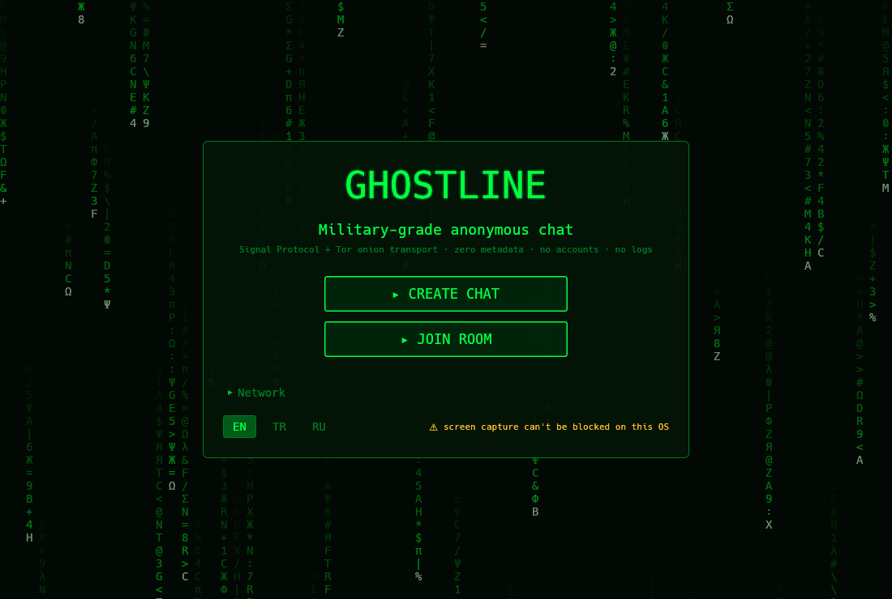
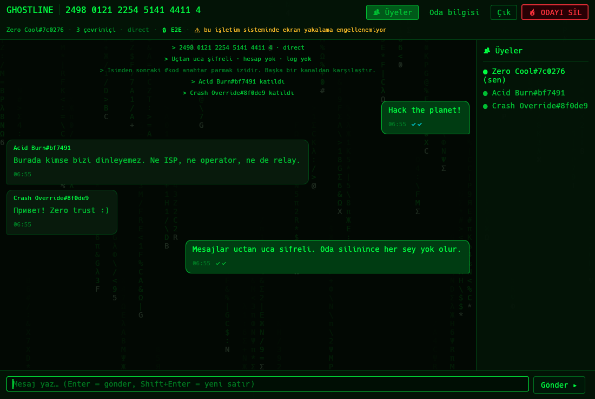
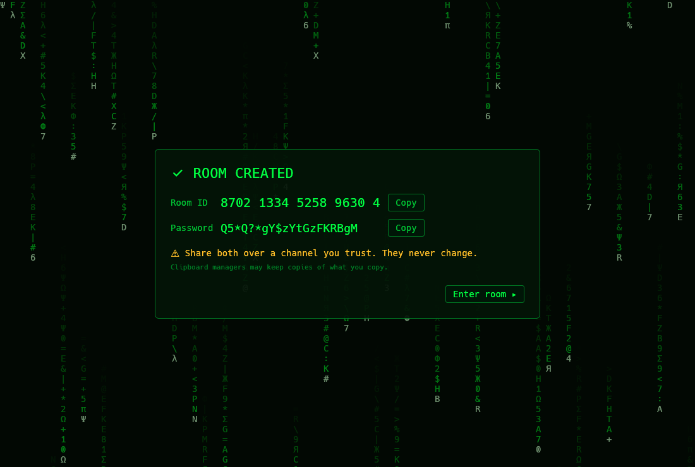

<p align="center"><a href="README.md">English</a> · <a href="README.tr.md">Türkçe</a> · <a href="README.ru.md">Русский</a> · <b>Deutsch</b></p>

<p align="center"></p>

# GhostLine

**Anonymer Chat auf militärischem Niveau: Signal Protocol + Tor-Onion-Transport, null Metadaten.**

<p align="center"><b><a href="https://github.com/canyorg/ghostline/releases/tag/latest">⬇ Download (Windows / Linux)</a></b> · <b><a href="#bedienungsanleitung-schritt-für-schritt">📖 Bedienungsanleitung</a></b></p>

Keine Konten. Keine Telefonnummern. Keine E-Mail. Keine IP-Adressen. Keine User-Agents. Keine Logs.
Du bekommst eine Raumnummer und ein Passwort, wählst einen Spitznamen, chattest und löschst den Raum am Ende.

> ⚠️ **Status: Pre-Alpha, nicht auditiert.** Die Bausteine sind etabliert (Tor, Argon2id,
> Signals libsignal, XChaCha20-Poly1305), aber diese Implementierung wurde noch nicht unabhängig
> geprüft. Verlass dich nicht darauf, wo deine Sicherheit davon abhängt, bis ein Audit erfolgt
> ist. Siehe [Bekannte Einschränkungen](#bekannte-einschränkungen).

<p align="center"></p>

---

## Warum GhostLine? Zero Trust

GhostLine ist so gebaut, dass du **niemandem vertrauen musst**: keinem Unternehmen, keinem
App-Anbieter, keinem Server und keinem Mobilfunkanbieter.

- **Mobilfunkanbieter:** SMS und Dienste des Anbieters lassen sich direkt abhören, vom
  Anbieter selbst, über Schwachstellen in SS7 oder von jedem, der Zugang zum Netz hat. Eine
  Telefonnummer ist außerdem eine Identität. GhostLine nutzt beides nicht.
- **WhatsApp ist eine Blackbox.** Es heißt, dort werde das Signal Protocol verwendet, aber der
  Client ist Closed Source, daher kann das niemand außerhalb des Unternehmens sicher überprüfen.
  Dazu sieht der Betreiber weiterhin die Metadaten: wer mit wem, wann und wie oft spricht.
  Viele Menschen vertrauen Meta schlicht nicht.
- **Zero Trust** heißt: niemals vertrauen, immer überprüfen. Für private Kommunikation bedeutet
  das offenen Code, keine Konten, keine Telefonnummern, Ende-zu-Ende-Verschlüsselung und einen
  Netzwerkweg, der verbirgt, wer du bist. Nach diesem Prinzip ist ein solches Werkzeug unverzichtbar.
- **Vertrau auch uns nicht.** Der Code ist offen (AGPL-3.0): lies ihn, baue ihn selbst und
  betreibe dein eigenes Relay. Das Relay speichert nur Chiffretext, also erfährt selbst ein
  feindliches Relay nichts Brauchbares.

**Das Projekt lässt sich verbessern, und wir freuen uns auf eure Ideen.** Eröffnet ein
[Issue](../../issues), startet eine Diskussion oder schickt einen Pull Request.

## Empfohlenes Setup: GhostLine + Mullvad VPN

GhostLine verbirgt deine IP dank Tor bereits vor dem Relay. Für echte Privatsphäre solltest du
auch vor deinem **Internetanbieter (ISP)** verbergen, dass du überhaupt Tor und GhostLine nutzt.
Wir empfehlen dafür [Mullvad VPN](https://mullvad.net): Es braucht keine E-Mail und keine
persönlichen Daten (nur eine Kontonummer), und die Apps sind Open Source. Aktiviere in Mullvad
vor dem Start von GhostLine:

| Einstellung | Wozu |
|---|---|
| **Kill Switch** (immer an) + **Lockdown-Modus** | Kein Datenverkehr verlässt den Rechner am VPN vorbei, auch nicht beim Neuverbinden oder bei getrenntem VPN |
| **DAITA** | Fügt Füll- und Tarnverkehr hinzu, damit KI-gestützte Verkehrsanalyse nicht erkennt, was du tust |
| **Multihop → Always** | Der Verkehr geht über einen Mullvad-Server hinein und über einen anderen hinaus, kein einzelner Server sieht beide Enden |

```
du ──► Mullvad (2 Hops, DAITA) ──► Tor (3 Hops) ──► relay.onion (3 Hops)
       ISP sieht nur Mullvad                 Relay sieht keine IP, nur Chiffretext
```

Diese Kombination ist das ideale Setup. Das VPN ist keine Pflicht, denn Tor allein verbirgt
deine IP schon vor dem Relay. Mullvad ist eine zusätzliche Schicht gegen ISP und lokales Netz.

## Bedienungsanleitung (Schritt für Schritt)

> **Kurzfassung:** App herunterladen → `.onion`-Adresse des Relays einfügen → auf
> „Tor bereit“ warten → **CHAT ERSTELLEN** oder **RAUM BEITRETEN**. Details unten.

### 1. Herunterladen und installieren

Du musst **weder** Rust, Git, Tor Browser noch sonst etwas installieren: Die App ist eine
einzige Datei mit eingebautem Tor. Die neueste Version liegt immer hier (kein GitHub-Konto nötig):
**[Releases → latest](https://github.com/canyorg/ghostline/releases/tag/latest)**

#### Windows 10 / 11

1. Lade **[ghostline-gui-x86_64-pc-windows-msvc.exe](https://github.com/canyorg/ghostline/releases/download/latest/ghostline-gui-x86_64-pc-windows-msvc.exe)** herunter.
2. Fragt der Browser, ob die Datei behalten werden soll, wähle **Behalten / Keep**.
3. *(Optional, empfohlen)* Prüfe, dass die Datei nicht manipuliert wurde. Öffne PowerShell im
   Downloads-Ordner und führe
   `Get-FileHash .\ghostline-gui-x86_64-pc-windows-msvc.exe -Algorithm SHA256` aus. Vergleiche
   das Ergebnis mit `SHA256SUMS-x86_64-pc-windows-msvc.txt` auf der Release-Seite.
4. Doppelklicke die `.exe`. Die Datei ist nicht signiert, daher zeigt Windows eventuell
   *„Der Computer wurde durch Windows geschützt“*: klicke **Weitere Informationen → Trotzdem ausführen**.
5. Es gibt keinen Installer. Leg die `.exe` ab, wo du willst, zum Beispiel auf den Desktop.

Die App startet in der Sprache deines Systems. Unten auf dem Startbildschirm kannst du
zwischen **EN · TR · RU · DE** wechseln.

#### Linux (Fedora, Ubuntu, Debian, Kali, Arch…)

```bash
cd ~/Downloads
wget https://github.com/canyorg/ghostline/releases/download/latest/ghostline-gui-x86_64-unknown-linux-gnu
sha256sum ghostline-gui-x86_64-unknown-linux-gnu   # mit SHA256SUMS-x86_64-unknown-linux-gnu.txt vergleichen
chmod +x ghostline-gui-x86_64-unknown-linux-gnu
./ghostline-gui-x86_64-unknown-linux-gnu
```

Terminal-Client (`ghostline-x86_64-…`) und Relay (`ghostline-relay-x86_64-…`) liegen auf
derselben Seite. Zum Bauen aus dem Quellcode siehe
[Aus dem Quellcode bauen](#aus-dem-quellcode-bauen-entwickler).

### 2. Was ist das Relay, und welche Adresse trage ich ein?

Ein **Relay** ist ein kleiner Briefkasten-Server, der die **verschlüsselten** Nachrichten
zwischen den Mitgliedern eines Raums weitergibt. Lesen kann er nichts (siehe
[Wie die Privatsphäre gewahrt bleibt](#wie-die-privatsphäre-gewahrt-bleibt)). Alle in einem Raum
müssen **dasselbe Relay** benutzen. Eine Person oder ein Server betreibt es.

Das Relay erreicht man über eine Tor-**Onion-Adresse** wie `abcd…xyz.onion`. Was du ins Feld
**Relay** einträgst, hängt davon ab, an welchem Rechner du sitzt:

| Du sitzt an… | Ins Feld **Relay** | Warum |
|---|---|---|
| **jedem anderen Rechner** (bei Freunden, am Laptop, in einem anderen Netz) | `http://abcd…xyz.onion` | Tor bringt dich zum Relay, keine IP wird sichtbar. **Kein Port.** |
| **dem Rechner, auf dem das Relay selbst läuft** | `http://127.0.0.1:7878` (Standard, nicht ändern) | Das Relay lauscht nur innerhalb dieses Rechners. Tor leitet die `.onion`-Adresse genau auf diesen Port weiter. |

Regeln, die Zeit sparen:

- **Mit `http://` beginnen**, nicht `https://`. Tor verschlüsselt und authentifiziert
  `.onion`-Verbindungen bereits. Vergisst du `http://`, ergänzt die App es selbst.
- **Kein Port nach `.onion`.** `:7878` wird nur auf dem Relay-Rechner selbst verwendet.
- **Adresse kopieren und einfügen.** Ein falscher Buchstabe ergibt eine andere (nicht existierende) Adresse.
- **Die Lausch-Adresse des Relays nicht ändern.** Sie muss `127.0.0.1:7878` bleiben, damit das
  Relay **nur über Tor** erreichbar ist. Öffnest du es ins Netz (`0.0.0.0`), können sich Leute
  ohne Tor verbinden, und das Relay sieht ihre IP.

**Warum gibt es kein Standard-Relay?** Absichtlich. Ein eingebautes Relay wäre ein zentraler Server,
dem alle vertrauen müssten und den jemand für alle abschalten könnte. Bei GhostLine betreibst du das
Relay selbst oder jemand, dem du vertraust. Das passt besser zu Zero Trust, und das Relay erfährt trotzdem nichts.

### 3. Eigenes Relay betreiben (einmalige Einrichtung, Linux)

Mach das auf einem Rechner oder Server, der **an und online** bleibt, solange ihr chattet; ein
günstiger VPS reicht völlig. Das Relay hält Räume **nur im RAM**: Stoppt es, sind alle Räume weg.

```bash
# 1) Relay herunterladen
wget https://github.com/canyorg/ghostline/releases/download/latest/ghostline-relay-x86_64-unknown-linux-gnu
chmod +x ghostline-relay-x86_64-unknown-linux-gnu

# 2) Tor installieren und das Relay als Onion-Dienst veröffentlichen — NUR EINMAL
sudo dnf install -y tor                 # Debian/Ubuntu/Kali: sudo apt install -y tor
echo -e "HiddenServiceDir /var/lib/tor/ghostline/\nHiddenServicePort 80 127.0.0.1:7878" | sudo tee -a /etc/tor/torrc
sudo systemctl enable --now tor
sudo systemctl restart tor

# 3) deine Relay-Adresse (die gibst du deinen Kontakten)
sleep 15; sudo cat /var/lib/tor/ghostline/hostname

# 4) Relay starten — dieses Terminal offen lassen
./ghostline-relay-x86_64-unknown-linux-gnu
```

- Schritt 2 **nur einmal** ausführen. Stehen dieselben Zeilen zweimal in der `torrc`, startet Tor eventuell nicht.
- Die `.onion`-Adresse bleibt nach Neustarts gleich. Sie liegt in `/var/lib/tor/ghostline/`;
  lösche diesen Ordner nicht, wenn du die Adresse behalten willst.
- Keine Portweiterleitung und keine feste IP nötig. Onion-Dienste funktionieren hinter jedem Heimrouter.
- Prüfen, ob Tor läuft: `systemctl is-active tor` muss `active` ausgeben.

### 4. Raum erstellen

1. App öffnen. Unter **Netzwerk → Relay** die Relay-Adresse einfügen (siehe Tabelle oben).
2. **Eingebautes Tor (empfohlen)** ausgewählt lassen. Warten, bis der Fortschrittsbalken voll
   ist und **„Tor bereit“** erscheint. Der erste Start dauert 10–60 Sekunden.
3. **CHAT ERSTELLEN** klicken.
4. Einen **Spitznamen** eingeben.
5. **Passwort:** **Automatisch erzeugen** lassen (am sichersten; **Passwort vorschlagen** liefert
   ein neues) oder **Eigenes festlegen** wählen (mindestens 12 Zeichen, zweimal eingeben).
6. **Raum erstellen** klicken. Du bekommst **Raum-ID** und **Passwort**, jeweils mit **Kopieren**-Knopf.
7. Schick beides über einen Kanal, dem du vertraust, an die andere Person (am besten persönlich). Beides ändert sich nie.
8. **Raum betreten** klicken.

### 5. Raum beitreten

1. App öffnen und dieselbe **Relay**-Adresse eintragen.
2. **RAUM BEITRETEN** klicken.
3. **Raum-ID:** eintippen oder einfügen. Leerzeichen sind egal. Tippfehler werden sofort erkannt
   (*„Prüfziffer falsch“*).
4. **Passwort:** einfügen. Mit **anzeigen** lässt es sich Zeichen für Zeichen vergleichen.
5. **Spitznamen** eingeben und **Beitreten** klicken. Über Tor kann die erste Verbindung 10–30 Sekunden dauern.

### 6. Im Raum

- **Senden:** tippen und **Enter** drücken (**Umschalt+Enter** = neue Zeile).
- **Häkchen:** ⏳ wird gesendet · ✔ auf dem Relay · ✔✔ an alle zugestellt · **cyanfarbene ✔✔** von allen gelesen.
- **Fingerabdruck:** `Acid Burn#afdb04`. Der `#Code` gehört zum Schlüssel dieser Person.
- **Sicherheitsnummer:** Öffne **Mitglieder**: Dort steht für jede Person eine 60-stellige
  Signal-Sicherheitsnummer. Vergleiche sie mit der Person persönlich oder am Telefon. Ist sie auf
  beiden Bildschirmen gleich, sitzt niemand dazwischen. Stimmt sie nicht überein oder ändert sich der
  `#Code` plötzlich, vertrau dem Gespräch nicht.
- **Mitglieder** zeigt, wer im Raum ist. **Rauminfo** zeigt ID und Passwort erneut.
- **Verlassen:** du verlässt den Raum; die anderen bekommen neue Schlüssel, du kannst nichts Späteres mehr lesen.
- **🔥 RAUM LÖSCHEN:** den Knopf **1,5 Sekunden** gedrückt halten. Der Raum wird sofort vom Relay
  gelöscht, alle Schlüssel werden vernichtet, und der Raum lässt sich nie wieder öffnen.
- Neue Mitglieder können Nachrichten von vor ihrem Beitritt nicht lesen. Das ist so gewollt.

### 7. Fehlerbehebung

| Meldung | Bedeutung / was tun |
|---|---|
| *room not found — or wrong password* (Raum nicht gefunden oder falsches Passwort) | Das Relay hat geantwortet, Tor funktioniert also. ID oder **Passwort** sind falsch (ein Zeichen reicht), oder das Relay wurde neu gestartet (Räume leben im RAM). Passwort per Kopieren einfügen oder neuen Raum erstellen. |
| *no relay is running on this computer (127.0.0.1)* (auf diesem Rechner läuft kein Relay) | Die Standardadresse steht noch drin. Auf jedem Rechner außer dem Relay selbst die `http://….onion`-Adresse eintragen. |
| *invalid relay URL* (ungültige Relay-Adresse) | Adresse prüfen, sie sollte wie `http://abcd…xyz.onion` aussehen. |
| Tor bleibt bei niedrigem % hängen | Kein Internet, oder Tor ist in diesem Netz blockiert. Zuerst mit Mullvad verbinden oder ein anderes Netz probieren. |
| *could not reach the relay through Tor* (Relay über Tor nicht erreichbar) | Der Relay-Rechner ist aus, das Relay-Programm läuft nicht, oder Tor läuft dort nicht (`systemctl is-active tor`). |
| *this room has been burned* (Raum wurde gelöscht) | Jemand hat den Raum gelöscht. Neuen Raum erstellen. |
| „Der Computer wurde durch Windows geschützt“ | Die `.exe` ist nicht signiert: **Weitere Informationen → Trotzdem ausführen**. Vorher SHA-256 prüfen. |

## Wie die Privatsphäre gewahrt bleibt

### Warum das Relay deine Nachrichten nicht lesen kann

Ende-zu-Ende heißt: Die Schlüssel existieren **nur auf den Geräten der Mitglieder**.

1. Das Passwort verlässt nie deinen Rechner. Argon2id macht daraus auf deinem Gerät den Raumschlüssel.
2. Jedes Mitglied erzeugt auf dem eigenen Gerät eine frische **Signal-Identität**, nur für diesen Raum.
   Jedes Mitgliederpaar baut eine **PQXDH- + Double-Ratchet-Sitzung** auf (Signals Bibliothek,
   Post-Quanten). Gruppenschlüssel werden nur über diese Sitzungen verteilt, daher kann selbst jemand
   mit dem Raumpasswort nichts lesen.
3. Jede Nachricht wird auf dem Gerät des Absenders verschlüsselt und nur auf den Geräten der
   Empfänger entschlüsselt. Dazwischen, über Tor und auf dem Relay, ist sie nur ein aufgefüllter,
   zufällig aussehender Datenblock.

Das Relay sieht nie ein Passwort, einen Schlüssel, einen Spitznamen oder eine Raum-ID. Es
speichert unlesbare Bytes unter einer zufälligen Briefkastenadresse. Ein feindlicher Betreiber,
ein Angreifer auf dem Server oder eine Beschlagnahme durch die Polizei liefert nichts Lesbares.
Weil benutzte Schlüssel sofort gelöscht werden, verrät selbst ein später gestohlenes Gerät
keine früheren Nachrichten (Forward Secrecy).

### Wie Tor deine IP verbirgt: 3 Relays, die einander nicht sehen

```
du ──► [1] Eingang (Guard) ──► [2] Mitte ──► [3] Treffpunkt ◄── 3 weitere Hops ◄── GhostLine-Relay (.onion)
       kennt deine IP,            kennt kein     kennt weder deine IP
       nicht das Ziel             Ende           noch die des Relays
```

Dein Verkehr ist in 3 Schichten Verschlüsselung verpackt (eine „Zwiebel“). Jedes Relay entfernt
genau eine Schicht und kennt nur den Schritt davor und danach:

- **[1] Eingang (Guard)** sieht deine IP, aber nicht, wohin der Verkehr geht.
- **[2] Mitte** sieht weder dich noch das Ziel.
- **[3] Letztes Relay** sieht den nächsten Schritt, aber nicht deine IP.

Kein einzelnes Relay sieht beide Enden; deshalb gelangt deine IP nicht nach außen. Das
GhostLine-Relay läuft als Onion-Dienst hinter eigenen 3 Hops: Der ganze Weg hat 6 Hops, keinen
Exit-Knoten, und das Relay erfährt keine einzige IP.

**Risiko:** Gehören das **1. und 3. Relay (oder dein Guard und die Seite des Relays) demselben
Betreiber**, kann dieser Zeitpunkte und Größen des Verkehrs an beiden Enden abgleichen und dich
mit dem Raum in Verbindung bringen (*Traffic-Correlation*-Angriff). Tor mindert das durch
langlebige Guards und indem Relays derselben erklärten Familie oder desselben /16-Netzes nicht
in eine Kette kommen, kann es gegen einen ressourcenstarken Angreifer aber nicht ausschließen.
**Genau deshalb ist Mullvad vor Tor sinnvoll:** Dein Guard sieht dann nur einen Mullvad-Server
statt deiner IP, und DAITA verwischt die Zeit- und Größenmuster, auf denen Korrelation beruht.

## Maximale OPSEC: in einer VM ausführen

Für maximale operative Sicherheit führe GhostLine in einer **Linux-VM (Fedora oder Kali)** aus
statt direkt unter Windows. Noch stärker sind Whonix, das die ganze VM über Tor leitet, und Tails.

**Warum nicht Windows?** Windows sendet Telemetrie, die an eine dauerhafte Gerätekennung gebunden
ist. 2026 enttarnte das FBI einen mutmaßlichen Scattered-Spider-Hacker unter anderem über die
**Global Device Identifier (GDID)** seines Windows: Dieselbe Windows-Installation wurde über alle
genutzten VPNs und IPs hinweg verknüpft und schließlich seiner Wohnadresse zugeordnet
([The Register](https://www.theregister.com/a/5267953), [CyberInsider](https://cyberinsider.com/microsoft-windows-telemetry-identified-hacker-despite-vpn-use/)).
Microsoft hat außerdem bestätigt, im Microsoft-Konto gespeicherte BitLocker-Wiederherstellungsschlüssel
auf gerichtliche Anordnung an Behörden herauszugeben
([Tom's Hardware](https://www.tomshardware.com/tech-industry/cyber-security/microsoft-gave-customers-bitlocker-encryption-keys-to-the-fbi-redmond-confirms-that-it-provides-recovery-keys-to-government-agencies-with-valid-legal-orders)).
Ende-zu-Ende-Verschlüsselung schützt dich nicht vor deinem eigenen Betriebssystem. **Unter Windows
ist die Microsoft-Telemetrie selbst ein OPSEC-Risiko.**

VM-Checkliste: Linux als Gast, vollständige Festplattenverschlüsselung, keine gemeinsame
Zwischenablage und keine geteilten Ordner mit dem Host, Mullvad (Lockdown-Modus + DAITA + Multihop)
auf dem Host oder in der VM, Tor in der VM und ein Snapshot, auf den du nach der Nutzung zurücksetzt.

## Funktionen

| | |
|---|---|
| 🔐 **Ende-zu-Ende-Verschlüsselung** | Signals eigene Bibliothek **libsignal**: Jedes Mitgliederpaar nutzt **PQXDH** (X25519 + ML-KEM-1024, Post-Quanten) und den **Double Ratchet**. Wie bei Signal bringt das Forward Secrecy *und* Post-Compromise Security. Gruppennachrichten nutzen Signals **Sender Keys** (wie in Signal- und WhatsApp-Gruppen); die Gruppenschlüssel werden über diese paarweisen Sitzungen verteilt und beim Verlassen eines Mitglieds sowie alle 100 Nachrichten erneuert. Mit **Sicherheitsnummern** könnt ihr euch gegenseitig überprüfen. |
| 🧅 **Eingebautes Tor** | Tor ist **in die App eingebaut** (Arti, die Rust-Implementierung des Tor Project). Kein Tor Browser und kein Tor-Dienst nötig: Die App verbindet sich selbst mit Tor. Jeder Raum hat eigene, isolierte Ketten, die alle 10 Minuten erneuert werden. Das Relay ist ein `.onion`-Dienst: 6 Hops, kein Exit-Knoten, der Server sieht keine IP. Ein entferntes Relay wird nie ohne Tor kontaktiert. Externes Tor (Tor Browser / Tor-Dienst) geht weiterhin. |
| 👻 **Null Metadaten** | Keine Konten, keine IPs, keine User-Agents, keine Kontaktlisten. Das Relay speichert nur aufgefüllten Chiffretext unter einer zufälligen Briefkastenadresse, im RAM. Spitznamen existieren nur in verschlüsselten Daten. |
| 🔢 **Numerische Raum-IDs** | Wie eine Krypto-Wallet oder eine Mullvad-Kontonummer: 16–23 Ziffern, **zufällige Länge**. Eine Damm-Prüfziffer erkennt jeden Einzelziffer-Tippfehler und jede Vertauschung zweier Nachbarziffern. |
| 🔑 **Raumpasswort** | Selbst festlegen oder automatisch erzeugen lassen. **„Passwort vorschlagen“** liefert 16+ zufällige Zeichen (standardmäßig ~123 Bit). ID und Passwort ändern sich nie. |
| 🏷️ **Spitzname pro Raum** | Wird beim Betreten gewählt und als `Spitzname#Fingerabdruck` angezeigt. Unicode erlaubt; unsichtbare und richtungsändernde Täuschungszeichen sind gesperrt. |
| ✓✓ **Zustellstatus** | ⏳ wird gesendet · ✓ auf dem Relay · ✓✓ an alle zugestellt · **cyanfarbene ✓✓** von allen gelesen. Bestätigungen sind verschlüsselt, Lesebestätigungen abschaltbar. |
| 🚫 **Screenshot-Schutz** | Desktop-App unter Windows: Das Fenster ist von Screenshots, Bildschirmaufnahmen und Bildschirmfreigabe ausgeschlossen. Unter Linux und im Terminal-Client nicht möglich, siehe Einschränkungen. |
| 💥 **Raum löschen** | `/burn` bzw. Knopf: Das Relay löscht den Briefkasten sofort (und sperrt ihn dauerhaft), alle Clients vernichten ihre Schlüssel. |
| 🟩 **Hacker-Oberfläche** | **Desktop-App** (Linux + Windows) mit Matrix-Regen, Sprechblasen und Löschen per Gedrückthalten, auf Englisch, Türkisch, Russisch und Deutsch. Dazu ein **Terminal-Client** in Grün auf Schwarz. Beide sprechen miteinander. |
| 🧱 **Keine Web-Engine** | Die Desktop-App ist reines Rust (egui): kein WebView, kein JavaScript, kein HTML. Nachrichten werden immer nur als reiner Text gezeichnet. Keine Nachrichten, Einstellungen oder Verläufe auf der Festplatte; nur der Tor-Zustand (Guards/Verzeichnis) wird wie beim Tor Browser gespeichert (`GHOSTLINE_AMNESIC=1` = gar nichts). |

## Aus dem Quellcode bauen (Entwickler)

Du brauchst [Rust](https://rustup.rs) und `protoc`, den Protocol-Buffers-Compiler, den libsignal benötigt
(Fedora: `sudo dnf install protobuf-compiler` · Debian/Ubuntu/Kali: `sudo apt install protobuf-compiler` ·
Windows: `winget install Google.Protobuf`). Läuft unter Linux (Fedora, Debian, Arch…), Windows 10/11
(PowerShell, Windows Terminal) und macOS.

```bash
git clone https://github.com/canyorg/ghostline && cd ghostline
cargo build --release
```

Die Programme liegen danach in `target/release/` (unter Windows mit `.exe`):

| Datei | Was es ist |
|---|---|
| `ghostline-gui` | Desktop-App |
| `ghostline` | Terminal-Client |
| `ghostline-relay` | Relay-Server |

### Desktop-App

```bash
./target/release/ghostline-relay &        # für einen lokalen Test; im Ernstfall ein .onion-Relay
./target/release/ghostline-gui
```

**CHAT ERSTELLEN** → Spitzname → Passwort (automatisch oder eigenes; **Passwort vorschlagen**
liefert ein neues) → Raum-ID und Passwort mit Kopierknöpfen → **Raum betreten**.
**RAUM BEITRETEN** → Raum-ID (Tippfehler werden beim Tippen erkannt) → Passwort → Spitzname.

Im Raum: 👥 Mitglieder, Rauminfo (ID + Passwort zum erneuten Teilen), **Verlassen** und
**🔥 RAUM LÖSCHEN**: 1,5 Sekunden gedrückt halten, und der Raum ist für alle weg. Relay- und
Tor-Einstellungen findest du unter **Netzwerk** auf dem Startbildschirm. Die Sprache folgt dem
System (EN/TR/RU/DE) und lässt sich dort umschalten.

<p align="center"> </p>

### Terminal-Client

Lokal in 3 Terminals ausprobieren:

```bash
# Terminal 1 — das Relay (nur RAM, protokolliert nichts)
./target/release/ghostline-relay

# Terminal 2 — Raum erstellen (bei der Passwortabfrage Enter = automatisch erzeugen)
./target/release/ghostline create --nick "Zero Cool"

# Terminal 3 — mit der ID + dem Passwort aus Terminal 2 beitreten
./target/release/ghostline join 1076 7380 0491 6080 894 --nick "Acid Burn"
```

Unter Windows `.\target\release\ghostline.exe` mit denselben Argumenten verwenden.

Im Raum: `/help` · `/who` · `/info` · `/quit` (Strg+C) · `/burn`

### Über Tor (echter Einsatz)

1. **Relay als Onion-Dienst betreiben** (auf einem beliebigen Linux-Rechner):

   ```bash
   sudo dnf install tor          # Debian/Ubuntu: sudo apt install tor
   sudo tee -a /etc/tor/torrc <<'TORRC'
   HiddenServiceDir /var/lib/tor/ghostline/
   HiddenServicePort 80 127.0.0.1:7878
   TORRC
   sudo systemctl restart tor
   sudo cat /var/lib/tor/ghostline/hostname     # → abcd…xyz.onion
   ./target/release/ghostline-relay              # bleibt auf 127.0.0.1
   ```

2. **Clients brauchen nichts weiter.** Tor ist eingebaut. Die `.onion`-Adresse ins Feld
   **Relay** einfügen (Desktop-App) oder mit `--relay` übergeben (Terminal). Beim ersten Start
   braucht Tor 10–60 Sekunden (Fortschrittsbalken), danach geht es schneller.

   ```bash
   ghostline create --relay http://abcd…xyz.onion
   ghostline join <ID> --relay http://abcd…xyz.onion
   ghostline join <ID> --relay http://abcd…xyz.onion --external-tor --tor-port 9150   # stattdessen Tor Browser nutzen
   ```

   Wie der Tor Browser merkt sich das eingebaute Tor seine Guard-Relays und einen
   Verzeichnis-Cache (`~/.local/share/ghostline/arti`, unter Windows `%LOCALAPPDATA%\ghostline\arti`).
   Stabile Guards **schützen** dich vor Korrelation. Für eine spurlose Sitzung
   `GHOSTLINE_AMNESIC=1` setzen: Tor nutzt dann einen temporären Ordner und löscht ihn beim Beenden.

   Tipp: `export GHOSTLINE_RELAY=http://abcd…xyz.onion` (PowerShell: `$env:GHOSTLINE_RELAY="…"`).

## Wie ein Raum funktioniert

```
ERSTELLEN                                BEITRETEN
Spitzname: Zero Cool                     Raum-ID  : 3414 7650 6754 3639 1733 042
Raum-ID  : 3414 7650 6754 3639 1733 042  Passwort : ********************
Passwort : [auto]  [vorschlagen]         Spitzname: Acid Burn
        └──► Argon2id(Passwort, ID) ──► Raumschlüssel · Briefkasten-ID · Löschschlüssel
```

Die ID allein nützt nichts: Die Briefkastenadresse wird aus dem **Passwort** abgeleitet, ohne
Passwort lässt sich der Raum nicht einmal finden. Ein falsches Passwort und ein nicht
existierender Raum sehen exakt gleich aus.

Details: [`docs/ARCHITECTURE.md`](docs/ARCHITECTURE.md) · [`docs/THREAT_MODEL.md`](docs/THREAT_MODEL.md)

## Bekannte Einschränkungen

Ein Sicherheitswerkzeug sollte offen sagen, was es **nicht** kann:

1. **Löschen ist nur bei unveränderten Clients garantiert.** „Raum löschen“ entfernt die Daten
   vom Relay und bei allen ehrlichen Clients. Ein manipulierter Client oder jemand, der die
   Nachrichten vorher kopiert hat, kann sie behalten. Kein Messenger kann das verhindern.
2. **Der Screenshot-Schutz ist begrenzt.** Der Terminal-Client hat keinen. Die Windows-Desktop-App
   verbirgt das Fenster vor Bildschirmaufnahmen, VMs oder Capture-Karten können das aber umgehen.
   Unter Linux ist es nicht möglich (X11; unter Wayland vom Compositor abhängig). Niemand kann
   verhindern, dass der Bildschirm mit dem Handy abfotografiert wird.
3. **Ein kompromittiertes Gerät hebelt alles aus.** Schadsoftware oder jemand an deinem
   entsperrten Rechner sieht, was du siehst.
4. **Das Raumpasswort ist ein gemeinsames Geheimnis.** Wer ID und Passwort kennt, kann beitreten
   und den Raum löschen. Dank Forward Secrecy kann er frühere Nachrichten nicht lesen.
5. **Schwache Passwörter lassen sich offline knacken**, wenn jemand die Relay-Daten hat. Argon2id
   (128 MiB) bremst das stark, trotzdem lieber die erzeugten Passwörter nutzen.
6. **Traffic-Correlation.** Kontrolliert dieselbe Partei dein 1. und 3. Tor-Relay (oder die Seite
   des Relays) oder beobachtet sie einfach beide Netzenden, kann sie Zeitpunkte und Größen abgleichen
   und dich dem Raum zuordnen. Tor macht das schwer, aber nicht unmöglich. Nutze Mullvad
   (Multihop + DAITA) vor Tor und schalte bei Bedarf Lesebestätigungen ab.
   Siehe [Wie die Privatsphäre gewahrt bleibt](#wie-die-privatsphäre-gewahrt-bleibt).
7. **Der Relay-Betreiber sieht** Briefkasten-IDs, aufgefüllte Größen und Eingangszeiten. IPs,
   Spitznamen, Raum-IDs, Passwörter und Inhalte sieht er **nicht**.
8. **In Ländern, die Tor blockieren,** brauchst du Bridges (oder Mullvad vor Tor).
9. **Speicherhygiene nach bestem Bemühen.** Schlüssel werden nach Gebrauch überschrieben, doch
   Swap, Ruhezustandsdatei und Absturzabbilder können Reste enthalten. Nutze Festplattenverschlüsselung.
10. **Wenn es darauf ankommt: Sicherheitsnummern vergleichen.** Der kurze `#Code` (24 Bit) hilft nur,
    einen Austausch zu bemerken. Um sicher zu wissen, mit wem du sprichst, vergleiche die 60-stelligen
    Sicherheitsnummern (siehe Bedienungsanleitung).
11. **libsignal wird außerhalb von Signal genutzt.** Signal unterstützt die Nutzung seiner Bibliothek
    durch Dritte nicht offiziell; GhostLine nutzt eine feste Version und aktualisiert sie bewusst.
12. **Noch nicht auditiert.**
13. **Dein Betriebssystem kann dich verraten.** Windows-Telemetrie bindet Aktivität an eine
    dauerhafte Geräte-ID. Führe GhostLine in einer Linux-VM aus, siehe
    [Maximale OPSEC](#maximale-opsec-in-einer-vm-ausführen).

## Roadmap

- [x] **M1** Raum-IDs (Damm), Passwortgenerator, Spitznamenprüfung, Argon2id/HKDF
- [x] **M2a** E2E-Gruppenchat (Sender Keys), Signaturen, Auffüllung, ✓/✓✓, neue Schlüssel beim Verlassen
- [x] **M3** Relay: nur RAM, keine Logs, TTL, sofortiges Löschen + dauerhafte Sperre (Tombstone)
- [x] **CLI** Terminal-Client für Linux und Windows, Tor über SOCKS
- [x] **M6a** Raum löschen
- [x] **M5** Desktop-App (Linux + Windows): Matrix-Oberfläche, Sprechblasen, ✔/✔✔, Löschen per Gedrückthalten, Screenshot-Schutz unter Windows, EN/TR/RU/DE
- [x] **M2b** Protokoll v2 auf `libsignal`: PQXDH + Double Ratchet, Sender Keys, Sicherheitsnummern
- [x] **M4a** Eingebautes Tor (Arti): eigene Ketten pro Raum, Erneuerung alle 10 Minuten, spurloser Modus
- [ ] **M4b** Bridges / Pluggable Transports für Länder, die Tor blockieren
- [ ] **M6b** Panik-Löschung, optional verschlüsselter lokaler Verlauf
- [ ] **M7** Android
- [ ] **M8** Unabhängiges Sicherheitsaudit

## Mitmachen

Ideen, Fehlerberichte, Übersetzungen, Code-Reviews und Pull Requests sind willkommen.
Sicherheitslücken bitte vertraulich melden, wie in [SECURITY.md](SECURITY.md) beschrieben.

```bash
cargo test                                   # Unit-Tests + Protokollsimulation
cargo clippy --all-targets -- -D warnings
```

```
crates/core    Protokollkern: IDs, KDF, Kryptografie, Nachrichtenformat, Sitzung
crates/relay   Relay-Server (nur RAM, keine Logs)
crates/client  gemeinsame Schicht: Relay-Verbindung (Tor/SOCKS), Erstellen/Beitreten, Raumsteuerung
crates/cli     Terminal-Client `ghostline`
crates/gui     Desktop-App `ghostline-gui` (egui)
docs/          Architektur und Bedrohungsmodell
```

## Lizenz

AGPL-3.0-or-later.
