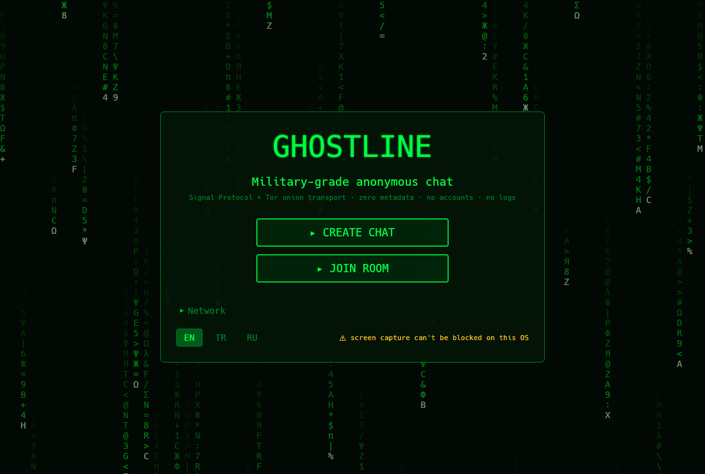
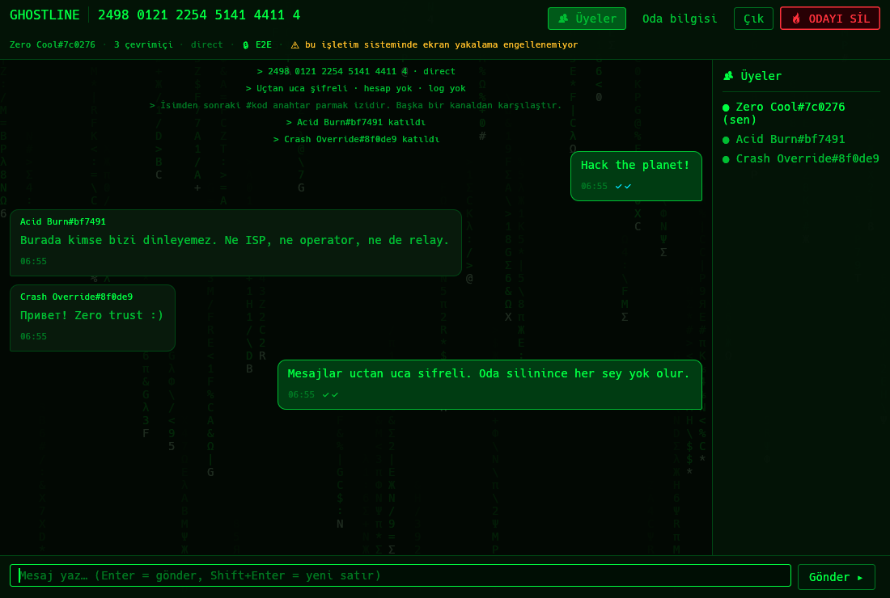
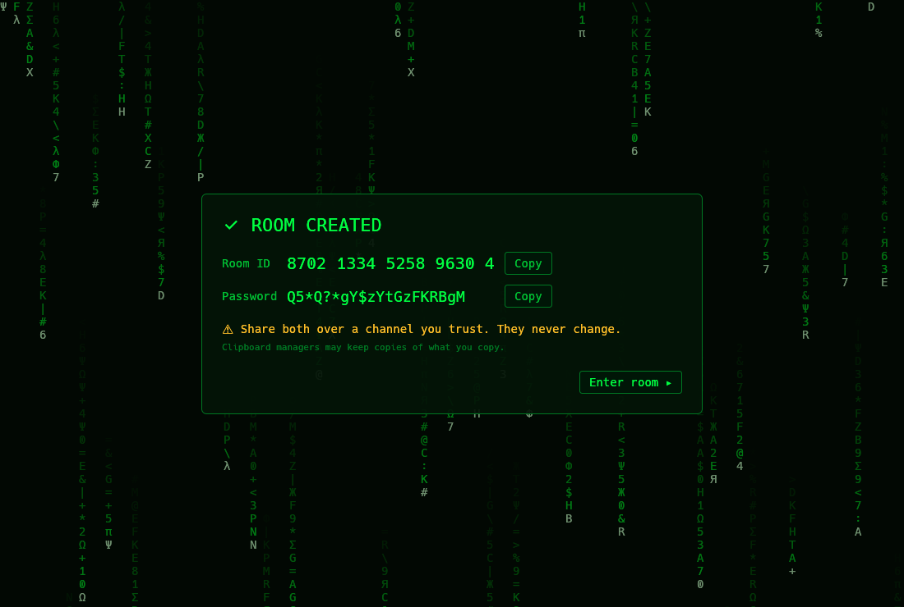

<p align="center"><b>English</b> · <a href="README.tr.md">Türkçe</a> · <a href="README.ru.md">Русский</a></p>

<p align="center"></p>

# GhostLine

**Military-grade anonymous chat — Signal Protocol + Tor onion transport, zero metadata.**

<p align="center"><b><a href="https://github.com/canyorg/ghostline/releases/tag/latest">⬇ Download (Windows / Linux)</a></b> · <b><a href="#user-guide-step-by-step">📖 User guide</a></b></p>

No accounts. No phone numbers. No e-mail. No IP addresses. No user agents. No logs.
You get a room number and a password, you pick a nickname, you talk, you burn the room.

> ⚠️ **Status: pre-alpha, not audited.** The building blocks are established (Tor, Argon2id,
> X25519, Ed25519, XChaCha20-Poly1305), but this implementation has not been reviewed
> independently. Do not rely on it where your safety depends on it until an audit is done.
> See [Known limitations](#known-limitations).

<p align="center"></p>

---

## Why GhostLine? Zero trust

GhostLine is built so that you **do not have to trust anyone**: no company, no app vendor,
no server and no mobile carrier.

- **Carriers:** SMS and carrier services can be intercepted directly — by the operator,
  through SS7 weaknesses, or by anyone with access to the network. A phone number is also
  an identity. GhostLine uses neither.
- **WhatsApp is a closed box.** It says it uses the Signal Protocol, but its client is
  closed-source, so nobody outside the company can verify this for certain. On top of that,
  the operator still sees metadata: who talks to whom, when and how often. Many people
  simply do not trust Meta.
- **Zero trust** says: never trust, always verify. For private communication that means
  open code, no accounts, no phone numbers, end-to-end encryption and a network path that
  hides who you are. Following this principle, a tool like this becomes unavoidable.
- **Don't trust us either.** The code is open (AGPL-3.0); read it, build it yourself, and run
  your own relay. The relay only ever holds ciphertext, so even a hostile relay learns nothing
  useful.

**It can be improved, and we'd like to hear your ideas.** Open an
[issue](../../issues), start a discussion or send a pull request.

## Recommended setup: GhostLine + Mullvad VPN

GhostLine already hides your IP from the relay through Tor. For real privacy you also want
to hide from your **ISP** the fact that you use Tor and GhostLine at all. We recommend
[Mullvad VPN](https://mullvad.net). It needs no e-mail or personal data (just an account
number) and its apps are open-source. Before you start GhostLine, turn these on in Mullvad:

| Setting | Why |
|---|---|
| **Kill switch** (always on) + **Lockdown mode** | No traffic ever leaves your machine outside the VPN, not even while it reconnects or is disconnected |
| **DAITA** | Adds padding and decoy traffic so AI-based traffic analysis cannot fingerprint what you do |
| **Multihop → Always** | Traffic enters through one Mullvad server and exits from another one, so no single server sees both ends |

```
you ──► Mullvad (2 hops, DAITA) ──► Tor (3 hops) ──► relay.onion (3 hops)
        ISP sees: Mullvad, nothing else     relay sees: no IP, only ciphertext
```

This combination is the ideal setup. The VPN is not required, since Tor alone already hides
your IP from the relay. Mullvad adds a layer against your ISP and local network.

## User guide (step by step)

> **Short version:** download the app → paste the relay's `.onion` address → wait for
> "Tor ready" → **CREATE CHAT** or **JOIN ROOM**. Details below.

### 1. Download and install

You do **not** need to install Rust, Git, Tor Browser or anything else: the app is a single
file with Tor built in. The newest build is always here (no GitHub account needed):
**[Releases → latest](https://github.com/canyorg/ghostline/releases/tag/latest)**

#### Windows 10 / 11

1. Download **[ghostline-gui-x86_64-pc-windows-msvc.exe](https://github.com/canyorg/ghostline/releases/download/latest/ghostline-gui-x86_64-pc-windows-msvc.exe)**.
2. If your browser asks whether to keep the file, choose **Keep**.
3. *(Optional, recommended)* Check that the file was not tampered with. Open PowerShell
   in your Downloads folder and run
   `Get-FileHash .\ghostline-gui-x86_64-pc-windows-msvc.exe -Algorithm SHA256`, then
   compare the result with `SHA256SUMS-x86_64-pc-windows-msvc.txt` on the release page.
4. Double-click the `.exe`. The file is not code-signed, so Windows may show
   *"Windows protected your PC"*. Click **More info → Run anyway**.
5. There is no installer. Keep the `.exe` wherever you like, for example on the desktop.

#### Linux (Fedora, Ubuntu, Debian, Kali, Arch…)

```bash
cd ~/Downloads
wget https://github.com/canyorg/ghostline/releases/download/latest/ghostline-gui-x86_64-unknown-linux-gnu
sha256sum ghostline-gui-x86_64-unknown-linux-gnu   # compare with SHA256SUMS-x86_64-unknown-linux-gnu.txt
chmod +x ghostline-gui-x86_64-unknown-linux-gnu
./ghostline-gui-x86_64-unknown-linux-gnu
```

The terminal client (`ghostline-x86_64-…`) and the relay (`ghostline-relay-x86_64-…`)
are on the same page. To build from source instead, see
[Build from source](#build-from-source-developers).

### 2. What is the relay, and which address do I type?

A **relay** is a small mailbox server that passes the **encrypted** messages between the
members of a room. It cannot read anything (see [How it stays private](#how-it-stays-private)).
Everyone in a room must use **the same relay**. One person, or a server, runs it.

The relay is reached through a Tor **onion address** like `abcd…xyz.onion`. What you type
into the **Relay** field depends on which computer you are on:

| You are on… | Type into **Relay** | Why |
|---|---|---|
| **any other computer** (your friend, your laptop, another network) | `http://abcd…xyz.onion` | Tor carries you to the relay; no IP is ever revealed. **No port number.** |
| **the computer that runs the relay itself** | `http://127.0.0.1:7878` (the default; leave it) | The relay only listens inside that computer. Tor forwards the `.onion` address to exactly this port. |

Rules that save you time:

- **Start with `http://`**, not `https://`. Tor already encrypts and authenticates
  `.onion` connections. If you forget `http://`, the app adds it for you.
- **No port after `.onion`.** Port `:7878` is only used on the relay computer itself.
- **Copy and paste** the address. One wrong letter means a different (non-existent) address.
- **Do not change the relay's listen address.** It must stay on `127.0.0.1:7878`, so it is
  reachable **only through Tor**. Opening it to the network (`0.0.0.0`) would let people
  connect without Tor, and the relay would see their IPs.

### 3. Run your own relay (one-time setup, Linux)

Do this on a computer or server that stays **on and online** while you chat; a cheap VPS
works well. The relay keeps rooms **only in RAM**, so if it stops, all rooms are gone.

```bash
# 1) download the relay
wget https://github.com/canyorg/ghostline/releases/download/latest/ghostline-relay-x86_64-unknown-linux-gnu
chmod +x ghostline-relay-x86_64-unknown-linux-gnu

# 2) install Tor and publish the relay as an onion service — ONLY ONCE
sudo dnf install -y tor                 # Debian/Ubuntu/Kali: sudo apt install -y tor
echo -e "HiddenServiceDir /var/lib/tor/ghostline/\nHiddenServicePort 80 127.0.0.1:7878" | sudo tee -a /etc/tor/torrc
sudo systemctl enable --now tor
sudo systemctl restart tor

# 3) your relay address (share this with your contacts)
sleep 15; sudo cat /var/lib/tor/ghostline/hostname

# 4) start the relay — keep this terminal open
./ghostline-relay-x86_64-unknown-linux-gnu
```

- Run step 2 **only once**. Adding the same lines to `torrc` twice can stop Tor from starting.
- The `.onion` address stays the same across restarts. It is stored in `/var/lib/tor/ghostline/`;
  keep that folder if you want to keep the address.
- No port forwarding and no static IP are needed. Onion services work behind any home router.
- Check that Tor runs: `systemctl is-active tor` should print `active`.

### 4. Create a room

1. Open the app. Under **Network → Relay**, paste the relay address (see the table above).
2. Leave **Built-in Tor (recommended)** selected. Wait until the progress bar finishes and
   **"Tor ready"** appears. The first start takes 10–60 s.
3. Click **CREATE CHAT**.
4. Enter a **nickname**.
5. **Password:** keep **Generate automatically** (strongest; **Suggest password** gives a new
   one), or choose **Set my own** (at least 12 characters, entered twice).
6. Click **Create room**. You get the **Room ID** and the **password**, each with a **Copy** button.
7. Send both to the other person over a channel you trust (in person is best). They never change.
8. Click **Enter room**.

### 5. Join a room

1. Open the app and set the same **Relay** address.
2. Click **JOIN ROOM**.
3. **Room ID:** type or paste it. Spaces don't matter. A typo is caught at once
   (*"check digit is wrong"*).
4. **Password:** paste it. Tick **show** to compare it character by character.
5. Enter a **nickname** and click **Join**. Over Tor the first connection can take 10–30 s.

### 6. In the room

- **Send:** type and press **Enter** (**Shift+Enter** for a new line).
- **Ticks:** ⏳ sending · ✔ on the relay · ✔✔ delivered to everyone · **cyan ✔✔** read by everyone.
- **Fingerprint:** `Acid Burn#afdb04`. The `#code` belongs to that person's key. If it suddenly
  changes, it is a different device or person.
- **Members** shows who is in the room. **Room info** shows the ID and password again.
- **Leave:** you leave; the others get new keys, so you can't read anything sent later.
- **🔥 BURN ROOM:** hold the button for **1.5 s**. The room is deleted from the relay at once,
  everyone's keys are wiped, and the room can never be opened again.
- New members cannot read messages sent before they joined. That is intended.

### 7. Troubleshooting

| Message | What it means / what to do |
|---|---|
| *room not found — or wrong password* | The relay answered, so Tor works. The ID or **password** is wrong (one character is enough), or the relay was restarted (rooms live in RAM). Copy-paste the password, or create a new room. |
| *no relay is running on this computer (127.0.0.1)* | You left the default address. On every computer except the relay itself, enter the relay's `http://….onion` address. |
| *invalid relay URL* | Check the address. It should look like `http://abcd…xyz.onion`. |
| Tor stays at a low % | No internet, or Tor is blocked on this network. Connect through Mullvad first, or try another network. |
| *could not reach the relay through Tor* | The relay computer is off, the relay program isn't running, or Tor isn't running there (`systemctl is-active tor`). |
| *this room has been burned* | Someone burned it. Create a new room. |
| "Windows protected your PC" | The `.exe` is not code-signed: **More info → Run anyway**. Check the SHA-256 first. |

## How it stays private

### Why the relay cannot read your messages

End-to-end means the keys exist **only on the members' devices**:

1. The password never leaves your computer. Argon2id turns it into the room key on your device.
2. Every member creates fresh secret keys on their own device. Each member's message keys are
   handed to the others individually, encrypted with X25519, so even someone who knows the room
   password cannot unwrap them.
3. Every message is encrypted on the sender's device and decrypted only on the recipients'
   devices. In between, through Tor and on the relay, it is just a padded, random-looking blob.

The relay never sees a password, a key, a nickname or a room ID. It stores unreadable bytes
under a random mailbox address. A hostile relay operator, a hacker on the server, or a police
seizure of the server gets nothing readable. Because used keys are deleted right away, even
stealing a device later does not reveal earlier messages (forward secrecy).

### How Tor hides your IP address: 3 relays that cannot see each other

```
you ──► [1] guard ──► [2] middle ──► [3] rendezvous ◄── 3 more hops ◄── GhostLine relay (.onion)
        knows your IP    knows neither   knows neither your IP
        not the target   end              nor the relay's
```

Your traffic is wrapped in 3 layers of encryption (an "onion"). Each relay removes exactly one
layer and only learns the hop before it and the hop after it:

- **[1] Guard** sees your IP address but not where the traffic is going.
- **[2] Middle** sees neither you nor the destination.
- **[3] Last relay** sees the next step but not your IP.

No single relay can see both ends, which is why your IP address does not leak. The GhostLine
relay runs as an onion service behind its own 3 hops, so the full path is 6 hops with no exit
node, and the relay never learns any IP.

**Risk:** if the **1st and 3rd relay (or your guard and the relay's side) belong to the same
operator**, that operator can match the timing and size of the traffic on both ends and link
you to the room (a *traffic correlation* attack). Tor reduces this by keeping long-lived guards
and not putting relays of the same declared family or /16 network in one circuit, but it cannot
rule it out against a well-resourced attacker. **This is exactly why Mullvad in front of Tor
makes sense:** your guard then only sees a Mullvad server, not your IP, and DAITA scrambles the
timing and size patterns that correlation depends on.

## Maximum OPSEC: run it in a VM

For maximum operational security, run GhostLine inside a **Linux virtual machine (Fedora or
Kali)** rather than directly on Windows. Even stronger options are Whonix, which routes the whole
VM through Tor, and Tails.

**Why not Windows?** Windows sends telemetry tied to a persistent device identifier.
In 2026 the FBI unmasked an alleged Scattered Spider hacker partly through his Windows **Global
Device Identifier (GDID)**: the same Windows installation was linked across all the VPNs and IPs
he used, and finally to his home address
([The Register](https://www.theregister.com/a/5267953), [CyberInsider](https://cyberinsider.com/microsoft-windows-telemetry-identified-hacker-despite-vpn-use/)). Microsoft
has also confirmed that it hands BitLocker recovery keys stored in Microsoft accounts to
authorities under a legal order ([Tom's Hardware](https://www.tomshardware.com/tech-industry/cyber-security/microsoft-gave-customers-bitlocker-encryption-keys-to-the-fbi-redmond-confirms-that-it-provides-recovery-keys-to-government-agencies-with-valid-legal-orders)). End-to-end
encryption cannot protect you from your own operating system. **On Windows, Microsoft's
telemetry is itself an OPSEC risk.**

VM checklist: Linux guest, full-disk encryption, no shared clipboard or folders with the host,
Mullvad (lockdown mode + DAITA + multihop) on the host or in the VM, Tor in the VM, and a
snapshot you can roll back after use.

## Features

| | |
|---|---|
| 🔐 **End-to-end encryption** | **Now:** Signal-style *Sender Keys*. Each member has a ratcheting chain (forward secrecy), keys are handed out pairwise over X25519, every message is Ed25519-signed, and everyone re-keys when someone leaves. Uses XChaCha20-Poly1305 and HKDF-SHA256. **Next:** full `libsignal` (PQXDH + Double Ratchet). |
| 🧅 **Built-in Tor** | Tor is **built into the app** (Arti, the Tor Project's Rust implementation). No Tor Browser and no tor service needed: open the app and it connects to Tor on its own. Each room gets its own isolated circuits, and circuits are replaced every 10 minutes. The relay is a `.onion` service, so the path has 6 hops, no exit node, and the server never sees an IP. A non-local relay is never contacted without Tor. You can still use an external Tor (Tor Browser / tor service). |
| 👻 **Zero metadata** | No accounts, no IPs, no user agents, no contact lists. The relay stores only padded ciphertext under a random mailbox address, in RAM. Nicknames exist only inside encrypted payloads. |
| 🔢 **Numeric room IDs** | Like a crypto wallet or a Mullvad account number: 16–23 digits with a **random length**. A Damm check digit catches every single-digit typo and every swap of two neighbouring digits. |
| 🔑 **Room password** | Set your own, or get one generated automatically. **"Suggest password"** produces 16+ random characters (~123 bits by default). The ID and password never change. |
| 🏷️ **Nickname per room** | Chosen when you enter a room, shown as `nick#fingerprint`. Unicode is allowed; invisible and bidi spoofing characters are blocked. |
| ✓✓ **Delivery status** | ⏳ sending · ✓ on relay · ✓✓ delivered to everyone · **cyan ✓✓** read by everyone. Receipts are encrypted and read receipts can be turned off. |
| 🚫 **Screenshot protection** | Desktop app on Windows: the window is excluded from screenshots, recordings and screen sharing. Linux and the terminal client cannot do this; see limitations. |
| 💥 **Burn room** | `/burn`: the relay deletes the mailbox instantly (and tombstones it), and every member's client wipes its keys. |
| 🟩 **Hacker UI** | **Desktop app** (Linux + Windows) with matrix rain, chat bubbles and hold-to-burn, in English, Turkish and Russian. Plus a green-on-black **terminal client**. Both talk to each other. |
| 🧱 **No web engine** | The desktop app is pure Rust (egui): no WebView, no JavaScript, no HTML. Message text is only ever drawn as plain text. No messages, settings or history are written to disk; only Tor's guard/directory state is kept, like Tor Browser (`GHOSTLINE_AMNESIC=1` = nothing at all). |

## Build from source (developers)

You need [Rust](https://rustup.rs). It works on Linux (Fedora, Debian, Arch…), Windows 10/11
(PowerShell, Windows Terminal) and macOS.

```bash
git clone https://github.com/canyorg/ghostline && cd ghostline
cargo build --release
```

The binaries end up in `target/release/` (`.exe` on Windows):

| Binary | What it is |
|---|---|
| `ghostline-gui` | desktop app |
| `ghostline` | terminal client |
| `ghostline-relay` | relay server |

### Desktop app

```bash
./target/release/ghostline-relay &        # for a local test; use an .onion relay for real
./target/release/ghostline-gui
```

**CREATE CHAT** → nickname → password (generated automatically, or your own; **Suggest password**
gives a new one) → you get the room ID + password with copy buttons → **Enter room**.
**JOIN ROOM** → room ID (typos are caught as you type) → password → nickname.

In the room: 👥 members, room info (ID + password to share again), **Leave**, and
**🔥 BURN ROOM**: hold it for 1.5 s and the room is gone for everyone. Relay and Tor settings
are under **Network** on the start screen. The language follows your system (EN/TR/RU) and
can be switched there.

<p align="center"> </p>

### Terminal client

Try it locally in 3 terminals:

```bash
# terminal 1 — the relay (RAM only, logs nothing)
./target/release/ghostline-relay

# terminal 2 — create a room (press Enter at the password prompt to auto-generate one)
./target/release/ghostline create --nick "Zero Cool"

# terminal 3 — join with the ID + password shown in terminal 2
./target/release/ghostline join 1076 7380 0491 6080 894 --nick "Acid Burn"
```

On Windows use `.\target\release\ghostline.exe` with the same arguments.

Inside a room: `/help` · `/who` · `/info` · `/quit` (Ctrl+C) · `/burn`

### Over Tor (real use)

1. **Run the relay as an onion service** on any Linux machine:

   ```bash
   sudo dnf install tor          # Debian/Ubuntu: sudo apt install tor
   sudo tee -a /etc/tor/torrc <<'TORRC'
   HiddenServiceDir /var/lib/tor/ghostline/
   HiddenServicePort 80 127.0.0.1:7878
   TORRC
   sudo systemctl restart tor
   sudo cat /var/lib/tor/ghostline/hostname     # → abcd…xyz.onion
   ./target/release/ghostline-relay              # stays on 127.0.0.1
   ```

2. **Clients need nothing extra.** Tor is built in. Paste the `.onion` address into the
   **Relay** field (desktop app) or pass `--relay` (terminal). On the first start Tor takes
   10–60 s to connect (progress bar), after that it is faster.

   ```bash
   ghostline create --relay http://abcd…xyz.onion
   ghostline join <ID> --relay http://abcd…xyz.onion
   ghostline join <ID> --relay http://abcd…xyz.onion --external-tor --tor-port 9150   # use Tor Browser instead
   ```

   Like Tor Browser, the built-in Tor remembers its guard relays and a directory cache
   (`~/.local/share/ghostline/arti`, on Windows `%LOCALAPPDATA%\ghostline\arti`). Stable
   guards **protect** you against correlation. For a leave-no-trace session set
   `GHOSTLINE_AMNESIC=1`: Tor then uses a temporary folder that is deleted on exit.

   Tip: `export GHOSTLINE_RELAY=http://abcd…xyz.onion` (PowerShell: `$env:GHOSTLINE_RELAY="…"`).

## How a room works

```
CREATE                                   JOIN
nickname: Zero Cool                      room id : 3414 7650 6754 3639 1733 042
room id : 3414 7650 6754 3639 1733 042   password: ********************
password: [auto]  [suggest]              nickname: Acid Burn
        └──► Argon2id(password, id) ──► room key · mailbox id · delete token
```

The ID alone is useless: the mailbox address is derived from the **password**, so without it
you cannot even find the room. A wrong password and a non-existent room look exactly the same.

Details: [`docs/ARCHITECTURE.md`](docs/ARCHITECTURE.md) · [`docs/THREAT_MODEL.md`](docs/THREAT_MODEL.md)

## Known limitations

A security tool should be upfront about what it **cannot** do:

1. **Deletion is only guaranteed for unmodified clients.** "Burn room" wipes the relay and
   every honest client. A modified client, or someone who copied the text earlier, can keep
   messages. No messenger can prevent this.
2. **Screenshot protection is limited.** The terminal client has none. The Windows desktop
   app hides the window from screen capture, though VMs or capture cards can get around it.
   On Linux it is not possible (X11, compositor-dependent on Wayland). No software can stop
   someone from photographing the screen.
3. **A compromised device defeats everything.** Malware or someone at your unlocked computer
   sees what you see.
4. **The room password is a shared secret.** Anyone with the ID and password can join and can
   burn the room. Thanks to forward secrecy they cannot read past messages.
5. **Weak passwords can be brute-forced offline** by someone who has the relay's data.
   Argon2id (128 MiB) slows this down a lot, but use the generated passwords.
6. **Traffic correlation.** If the same party controls your 1st Tor relay and the 3rd one
   (or the relay's side), or simply watches both ends of the network, it can match timing and
   sizes and link you to the room. Tor makes this hard but not impossible. Use Mullvad
   (multihop + DAITA) in front of Tor, and turn off read receipts if needed.
   See [How it stays private](#how-it-stays-private).
7. **The relay operator sees** mailbox IDs, padded sizes and arrival times. It does **not** see
   IPs, nicknames, room IDs, passwords or content.
8. **In countries that block Tor** you will need bridges (or Mullvad in front of Tor).
9. **Memory hygiene is best-effort.** Keys are zeroized after use, but swap, hibernation files
   and crash dumps can still hold secrets. Use full-disk encryption.
10. **Interim group crypto.** v0 Sender Keys give forward secrecy but no post-compromise
    security. libsignal is on the roadmap.
11. **Fingerprints are short.** `#1a2b3c` is 24 bits: enough to notice a swap, not enough to
    prove identity.
12. **Not audited yet.**
13. **Your operating system can betray you.** Windows telemetry ties activity to a persistent
    device ID. Run GhostLine in a Linux VM; see [Maximum OPSEC](#maximum-opsec-run-it-in-a-vm).

## Roadmap

- [x] **M1** Room IDs (Damm), password generator, nickname validation, Argon2id/HKDF
- [x] **M2a** E2E group messaging (Sender Keys), signatures, padding, ✓/✓✓ receipts, re-key on leave
- [x] **M3** Relay: RAM only, no logs, TTL, instant delete + tombstone
- [x] **CLI** Terminal client for Linux and Windows, Tor via SOCKS
- [x] **M6a** Burn room
- [x] **M5** Desktop app (Linux + Windows): matrix UI, bubbles, ✔/✔✔, hold-to-burn, screen-capture exclusion on Windows, EN/TR/RU
- [ ] **M2b** `libsignal` (PQXDH + Double Ratchet)
- [x] **M4a** Built-in Tor (Arti): per-room circuit isolation, rotation every 10 min, amnesic mode
- [ ] **M4b** Bridges / pluggable transports for countries that block Tor
- [ ] **M6b** Panic wipe, optional encrypted local history
- [ ] **M7** Android
- [ ] **M8** External security audit

## Contributing

Ideas, bug reports, translations, code reviews and pull requests are all welcome. Please
report security problems privately, as described in [SECURITY.md](SECURITY.md).

```bash
cargo test                                   # unit + protocol simulation tests
cargo clippy --all-targets -- -D warnings
```

```
crates/core    protocol core: IDs, KDF, crypto, wire format, sans-IO session
crates/relay   relay server (RAM only, no logs)
crates/client  shared runtime: relay transport (Tor/SOCKS), create/join, room driver
crates/cli     terminal client `ghostline`
crates/gui     desktop app `ghostline-gui` (egui)
docs/          architecture and threat model
```

## License

AGPL-3.0-or-later.
