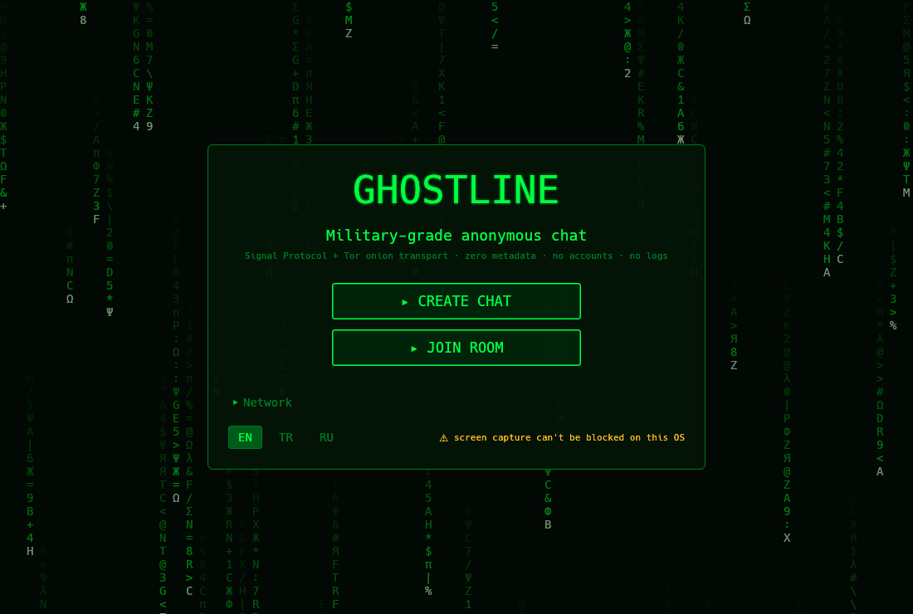
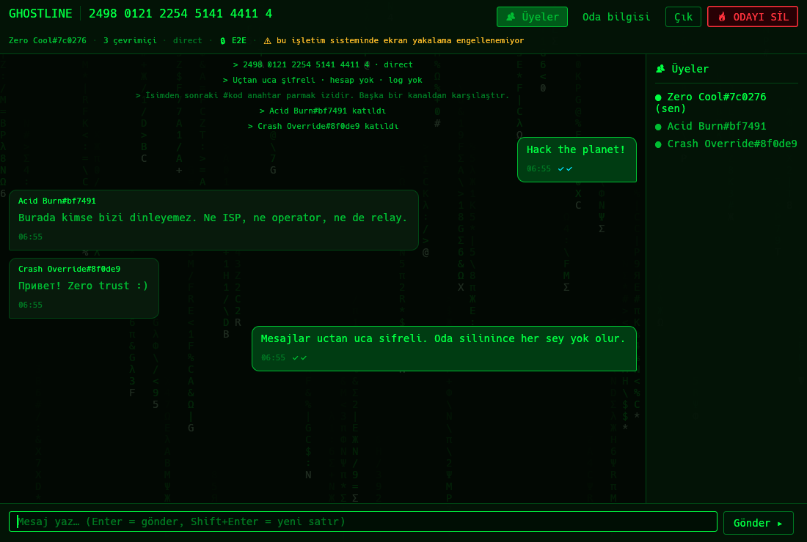
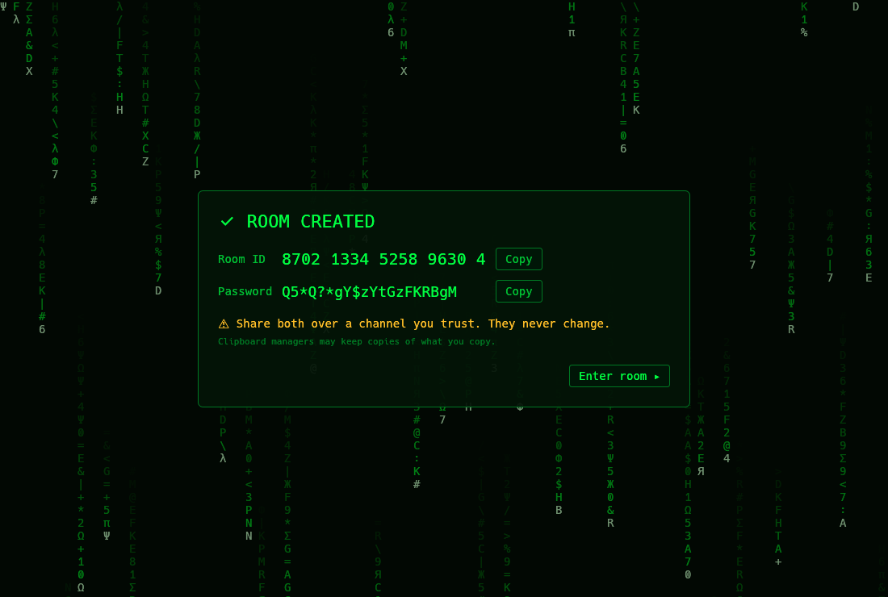

<p align="center"><a href="README.md">English</a> · <a href="README.tr.md">Türkçe</a> · <b>Русский</b> · <a href="README.de.md">Deutsch</a></p>

<p align="center"></p>

# GhostLine

**Анонимный чат военного уровня: Signal Protocol + транспорт через Tor (onion), ноль метаданных.**

<p align="center"><b><a href="https://github.com/canyorg/ghostline/releases/tag/latest">⬇ Скачать (Windows / Linux)</a></b> · <b><a href="#руководство-пользователя-шаг-за-шагом">📖 Руководство</a></b></p>

Без аккаунтов. Без номеров телефонов. Без e-mail. Без IP-адресов. Без user agent. Без логов.
Ты получаешь номер комнаты и пароль, выбираешь ник, общаешься и, когда закончишь, сжигаешь комнату.

> ⚠️ **Статус: pre-alpha, аудит не проводился.** Используются проверенные компоненты
> (Tor, Argon2id, X25519, Ed25519, XChaCha20-Poly1305), но сама реализация ещё не проходила
> независимую проверку. Пока не проведён аудит, не полагайся на неё там, где от этого зависит
> твоя безопасность. См. [Известные ограничения](#известные-ограничения).

<p align="center"></p>

---

## Зачем GhostLine? Zero trust (нулевое доверие)

GhostLine создан для того, чтобы тебе **не нужно было никому доверять**: ни компаниям,
ни приложениям, ни серверам, ни мобильным операторам.

- **Операторы связи:** SMS и сервисы оператора можно перехватить напрямую. Это может сделать
  сам оператор, кто-то через уязвимости SS7 или любой, у кого есть доступ к сети. К тому же
  номер телефона — это твоя личность. GhostLine не использует ни то, ни другое.
- **WhatsApp — закрытый ящик.** Компания заявляет, что использует Signal Protocol, но клиент
  закрыт, поэтому никто за пределами компании не может это точно проверить. Кроме того,
  оператор всё равно видит метаданные: кто с кем общается, когда и как часто. Многие просто
  не доверяют Meta.
- **Zero trust** гласит: «никогда не доверяй, всегда проверяй». Для приватного общения это
  значит открытый код, отсутствие аккаунтов и номеров, сквозное шифрование и сетевой путь,
  скрывающий, кто ты. Следуя этому принципу, без такого инструмента не обойтись.
- **Не доверяй и нам.** Код открыт (AGPL-3.0). Читай его, собирай сам и запускай собственный
  relay. Relay хранит только шифротекст, поэтому даже враждебный relay не узнает ничего полезного.

**Проект можно улучшать, ждём ваших идей.** Открывай [issue](../../issues), начинай
обсуждение или присылай pull request.

## Рекомендуемая схема: GhostLine + Mullvad VPN

GhostLine уже скрывает твой IP от relay благодаря Tor. Для настоящей приватности стоит
скрыть и от **провайдера (ISP)** сам факт того, что ты используешь Tor и GhostLine. Для этого
мы рекомендуем [Mullvad VPN](https://mullvad.net): он не требует e-mail и личных данных (только
номер аккаунта), а его приложения открыты. Перед запуском GhostLine включи в Mullvad:

| Настройка | Зачем |
|---|---|
| **Kill switch** (всегда включён) + **Lockdown mode** | Никакой трафик не уходит в обход VPN, даже во время переподключения или при отключённом VPN |
| **DAITA** | Добавляет заполнение и фиктивный трафик, чтобы анализ трафика с помощью ИИ не мог определить, что ты делаешь |
| **Multihop → Always** | Трафик входит через один сервер Mullvad, а выходит через другой, и ни один сервер не видит оба конца |

```
ты ──► Mullvad (2 хопа, DAITA) ──► Tor (3 хопа) ──► relay.onion (3 хопа)
       провайдер видит только Mullvad        relay не видит IP, только шифротекст
```

Эта комбинация — идеальная система. VPN не обязателен, потому что Tor сам по себе скрывает
IP от relay. Mullvad добавляет дополнительный слой защиты от провайдера и локальной сети.

## Руководство пользователя (шаг за шагом)

> **Коротко:** скачай приложение → вставь `.onion`-адрес relay → дождись «Tor готов» →
> **СОЗДАТЬ ЧАТ** или **ВОЙТИ В КОМНАТУ**. Подробности ниже.

### 1. Скачивание и установка

Устанавливать Rust, Git, Tor Browser или что-то ещё **не нужно**: приложение — это один файл
со встроенным Tor. Самая свежая сборка всегда здесь (аккаунт GitHub не нужен):
**[Releases → latest](https://github.com/canyorg/ghostline/releases/tag/latest)**

#### Windows 10 / 11

1. Скачай **[ghostline-gui-x86_64-pc-windows-msvc.exe](https://github.com/canyorg/ghostline/releases/download/latest/ghostline-gui-x86_64-pc-windows-msvc.exe)**.
2. Если браузер спросит, сохранить ли файл, выбери **Сохранить / Keep**.
3. *(Необязательно, но рекомендуется)* Проверь, что файл не подменён. Открой PowerShell в папке
   «Загрузки» и выполни `Get-FileHash .\ghostline-gui-x86_64-pc-windows-msvc.exe -Algorithm SHA256`.
   Сравни результат с `SHA256SUMS-x86_64-pc-windows-msvc.txt` на странице релиза.
4. Дважды щёлкни по `.exe`. Файл не подписан, поэтому Windows может показать *«Система Windows
   защитила ваш компьютер»*: нажми **Подробнее → Выполнить в любом случае**.
5. Установки нет. Храни `.exe` где удобно, например на рабочем столе.

#### Linux (Fedora, Ubuntu, Debian, Kali, Arch…)

```bash
cd ~/Загрузки            # в английской системе: cd ~/Downloads
wget https://github.com/canyorg/ghostline/releases/download/latest/ghostline-gui-x86_64-unknown-linux-gnu
sha256sum ghostline-gui-x86_64-unknown-linux-gnu   # сравни с SHA256SUMS-x86_64-unknown-linux-gnu.txt
chmod +x ghostline-gui-x86_64-unknown-linux-gnu
./ghostline-gui-x86_64-unknown-linux-gnu
```

Терминальный клиент (`ghostline-x86_64-…`) и relay (`ghostline-relay-x86_64-…`) лежат на той
же странице. Сборка из исходников описана в разделе
[Сборка из исходников](#сборка-из-исходников-для-разработчиков).

### 2. Что такое relay и какой адрес вводить?

**Relay** — это небольшой сервер-«почтовый ящик», который передаёт **зашифрованные** сообщения
между участниками комнаты. Прочитать он ничего не может (см.
[Как обеспечивается приватность](#как-обеспечивается-приватность)). Все в комнате должны
использовать **один и тот же relay**. Запускает его один человек или сервер.

К relay подключаются через **onion-адрес** Tor вида `abcd…xyz.onion`. Что вписать в поле
**Relay**, зависит от того, на каком компьютере ты находишься:

| Ты на… | Впиши в **Relay** | Почему |
|---|---|---|
| **любом другом компьютере** (у друга, на ноутбуке, в другой сети) | `http://abcd…xyz.onion` | Tor доставит тебя к relay, IP никто не увидит. **Порт не нужен.** |
| **том компьютере, где работает сам relay** | `http://127.0.0.1:7878` (по умолчанию, не трогай) | Relay слушает только внутри этого компьютера. Tor перенаправляет `.onion`-адрес именно на этот порт. |

Правила, которые сэкономят время:

- **Начинай с `http://`**, а не `https://`. Tor и так шифрует и проверяет `.onion`-соединения.
  Если забудешь `http://`, приложение добавит его само.
- **После `.onion` порт не пишется.** `:7878` используется только на самом компьютере с relay.
- **Копируй и вставляй** адрес. Одна неверная буква — это другой (несуществующий) адрес.
- **Не меняй адрес, на котором слушает relay.** Он должен оставаться `127.0.0.1:7878`, чтобы
  к relay можно было попасть **только через Tor**. Если открыть его в сеть (`0.0.0.0`), люди
  смогут подключаться без Tor, и relay увидит их IP.

### 3. Свой relay (настраивается один раз, Linux)

Делай это на компьютере или сервере, который будет **включён и в сети**, пока вы общаетесь;
дешёвый VPS подойдёт. Relay хранит комнаты **только в RAM**: если он остановится, все комнаты исчезнут.

```bash
# 1) скачать relay
wget https://github.com/canyorg/ghostline/releases/download/latest/ghostline-relay-x86_64-unknown-linux-gnu
chmod +x ghostline-relay-x86_64-unknown-linux-gnu

# 2) установить Tor и опубликовать relay как onion-сервис — ТОЛЬКО ОДИН РАЗ
sudo dnf install -y tor                 # Debian/Ubuntu/Kali: sudo apt install -y tor
echo -e "HiddenServiceDir /var/lib/tor/ghostline/\nHiddenServicePort 80 127.0.0.1:7878" | sudo tee -a /etc/tor/torrc
sudo systemctl enable --now tor
sudo systemctl restart tor

# 3) адрес твоего relay (его и передаёшь собеседникам)
sleep 15; sudo cat /var/lib/tor/ghostline/hostname

# 4) запустить relay — не закрывай этот терминал
./ghostline-relay-x86_64-unknown-linux-gnu
```

- Шаг 2 выполняй **только один раз**. Если добавить те же строки в `torrc` дважды, Tor может не запуститься.
- `.onion`-адрес не меняется после перезапуска. Он хранится в `/var/lib/tor/ghostline/`;
  не удаляй эту папку, если хочешь сохранить адрес.
- Проброс портов и статический IP не нужны. Onion-сервисы работают за любым домашним роутером.
- Проверь, что Tor работает: `systemctl is-active tor` должен вывести `active`.

### 4. Создать комнату

1. Открой приложение. В разделе **Сеть → Relay** вставь адрес relay (см. таблицу выше).
2. Оставь **Встроенный Tor (рекомендуется)**. Дождись, пока заполнится полоса прогресса и
   появится **«Tor готов»**. Первый запуск занимает 10–60 секунд.
3. Нажми **СОЗДАТЬ ЧАТ**.
4. Введи **ник**.
5. **Пароль:** оставь **Сгенерировать автоматически** (самый надёжный вариант; **Предложить
   пароль** выдаёт новый) или выбери **Задать свой** (минимум 12 символов, ввести дважды).
6. Нажми **Создать комнату**. Появятся **ID комнаты** и **пароль**, у каждого кнопка **Копировать**.
7. Передай оба значения собеседнику по каналу, которому доверяешь (лучше всего лично). Они не меняются.
8. Нажми **Войти**.

### 5. Войти в комнату

1. Открой приложение и укажи тот же адрес **Relay**.
2. Нажми **ВОЙТИ В КОМНАТУ**.
3. **ID комнаты:** введи или вставь. Пробелы не важны. Опечатка видна сразу
   (*«контрольная цифра неверна»*).
4. **Пароль:** вставь. Отметь **показать**, чтобы сверить его посимвольно.
5. Введи **ник** и нажми **Войти**. Через Tor первое подключение может занять 10–30 секунд.

### 6. В комнате

- **Отправить:** напиши и нажми **Enter** (**Shift+Enter** — новая строка).
- **Отметки:** ⏳ отправка · ✔ на relay · ✔✔ доставлено всем · **голубые ✔✔** прочитано всеми.
- **Отпечаток:** `Acid Burn#afdb04`. `#код` принадлежит ключу этого человека. Если он вдруг
  изменился, это другое устройство или другой человек.
- **Участники** показывает, кто в комнате. **Инфо** снова показывает ID и пароль.
- **Выйти:** ты выходишь из комнаты; остальные получают новые ключи, и ты не сможешь читать дальше.
- **🔥 СЖЕЧЬ КОМНАТУ:** удерживай кнопку **1,5 секунды**. Комната сразу удаляется с relay,
  ключи у всех стираются, и открыть её снова будет невозможно.
- Новые участники не видят сообщений, отправленных до их входа. Так и задумано.

### 7. Решение проблем

| Сообщение | Что значит / что делать |
|---|---|
| *room not found — or wrong password* (комната не найдена или неверный пароль) | Relay ответил, значит Tor работает. Неверен ID или **пароль** (достаточно одного символа), либо relay перезапускали (комнаты живут в RAM). Вставь пароль через копирование или создай новую комнату. |
| *no relay is running on this computer (127.0.0.1)* (на этом компьютере нет relay) | Остался адрес по умолчанию. На всех компьютерах, кроме самого relay, укажи `http://….onion`. |
| *invalid relay URL* (неверный адрес relay) | Проверь адрес, он должен выглядеть как `http://abcd…xyz.onion`. |
| Tor застрял на низком % | Нет интернета или Tor заблокирован в этой сети. Сначала подключись к Mullvad или попробуй другую сеть. |
| *could not reach the relay through Tor* (relay недоступен через Tor) | Компьютер с relay выключен, relay не запущен или там не работает Tor (`systemctl is-active tor`). |
| *this room has been burned* (комната сожжена) | Кто-то сжёг комнату. Создай новую. |
| «Система Windows защитила ваш компьютер» | `.exe` не подписан: **Подробнее → Выполнить в любом случае**. Сначала проверь SHA-256. |

## Как обеспечивается приватность

### Почему relay не может прочитать твои сообщения

Сквозное шифрование означает, что ключи есть **только на устройствах участников**:

1. Пароль никогда не покидает твой компьютер. Argon2id превращает его в ключ комнаты прямо на устройстве.
2. Каждый участник создаёт новые секретные ключи на своём устройстве. Ключи сообщений каждого
   участника передаются остальным по отдельности, зашифрованными через X25519, так что даже
   знающий пароль комнаты не сможет их расшифровать.
3. Каждое сообщение шифруется на устройстве отправителя и расшифровывается только на устройствах
   получателей. В пути, через Tor и на relay, это лишь выровненный по размеру набор случайных на вид байтов.

Relay никогда не видит ни пароля, ни ключей, ни ников, ни ID комнаты. Он хранит нечитаемые байты
по случайному адресу ящика. Враждебный оператор relay, взломщик сервера или полиция, изъявшая
сервер, не получат ничего читаемого. Использованные ключи сразу удаляются, поэтому даже кража
устройства позже не раскроет прошлые сообщения (forward secrecy).

### Как Tor скрывает IP-адрес: 3 relay, которые не видят друг друга

```
ты ──► [1] входной (guard) ──► [2] средний ──► [3] точка встречи ◄── ещё 3 хопа ◄── GhostLine relay (.onion)
       знает твой IP,             не знает        не знает ни твой IP,
       не знает цель              ни одного конца ни IP relay
```

Твой трафик завёрнут в 3 слоя шифрования («луковица»). Каждый relay снимает ровно один слой и
узнаёт только предыдущий и следующий шаг:

- **[1] Входной (guard)** видит твой IP, но не знает, куда идёт трафик.
- **[2] Средний** не видит ни тебя, ни цель.
- **[3] Последний** видит следующий шаг, но не твой IP.

Ни один relay не видит оба конца сразу, поэтому твой IP не утекает. Relay GhostLine работает как
onion-сервис за собственными 3 хопами: весь путь — 6 хопов без выходного (exit) узла, и relay не
узнаёт ни одного IP.

**Риск:** если **1-й и 3-й relay (или твой входной relay и сторона сервера) принадлежат одному
оператору**, он может сопоставить время и размер трафика на обоих концах и связать тебя с комнатой
(атака *корреляции трафика*). Tor снижает этот риск: входные узлы долго не меняются, а relay одной
заявленной семьи или одной сети /16 не попадают в одну цепочку. Но против противника с большими
ресурсами полностью исключить это нельзя. **Именно поэтому Mullvad перед Tor имеет смысл:** входной
relay видит только сервер Mullvad, а не твой IP, а DAITA размывает шаблоны времени и размера, на
которых держится корреляция.

## Максимальный OPSEC: запускай в виртуальной машине

Для максимальной операционной безопасности запускай GhostLine не прямо на Windows, а в
**виртуальной машине с Linux (Fedora или Kali)**. Ещё надёжнее — Whonix, который пускает всю
виртуальную машину через Tor, и Tails.

**Почему не Windows?** Windows отправляет телеметрию, привязанную к постоянному идентификатору
устройства. В 2026 году ФБР вычислило предполагаемого участника Scattered Spider в том числе по
**Global Device Identifier (GDID)** его Windows: одну и ту же установку Windows отследили через все
VPN и IP, которыми он пользовался, и в итоге связали с его домашним адресом
([The Register](https://www.theregister.com/a/5267953), [CyberInsider](https://cyberinsider.com/microsoft-windows-telemetry-identified-hacker-despite-vpn-use/)). Microsoft также подтвердила, что по
судебному решению передаёт властям ключи восстановления BitLocker, хранящиеся в учётной записи
Microsoft ([Tom's Hardware](https://www.tomshardware.com/tech-industry/cyber-security/microsoft-gave-customers-bitlocker-encryption-keys-to-the-fbi-redmond-confirms-that-it-provides-recovery-keys-to-government-agencies-with-valid-legal-orders)). Сквозное шифрование не защитит тебя от собственной
операционной системы. **На Windows телеметрия Microsoft сама по себе является риском для OPSEC.**

Чек-лист для ВМ: гостевая Linux, полное шифрование диска, без общего буфера обмена и папок с хостом,
Mullvad (lockdown mode + DAITA + multihop) на хосте или в ВМ, Tor в ВМ и снапшот, к которому можно
откатиться после использования.

## Возможности

| | |
|---|---|
| 🔐 **Сквозное шифрование** | **Сейчас:** групповая схема Signal — *Sender Keys*. У каждого участника своя ключевая цепочка, которая только движется вперёд (forward secrecy), ключи раздаются каждому лично через X25519, каждое сообщение подписано Ed25519, а при выходе участника все меняют ключи. Используются XChaCha20-Poly1305 и HKDF-SHA256. **Далее:** полноценный `libsignal` (PQXDH + Double Ratchet). |
| 🧅 **Встроенный Tor** | Tor **встроен в приложение** (Arti — реализация Tor на Rust от Tor Project). Не нужны ни Tor Browser, ни служба tor: приложение само подключается к Tor. У каждой комнаты свои изолированные цепочки, цепочки меняются каждые 10 минут. Relay — это `.onion`-сервис: путь из 6 хопов, без выходного узла, сервер не видит ни одного IP. К удалённому relay без Tor приложение никогда не подключается. При желании можно использовать внешний Tor (Tor Browser / служба tor). |
| 👻 **Ноль метаданных** | Нет аккаунтов, IP, user agent и списков контактов. Relay хранит в RAM только шифротекст с выравниванием размера по случайному адресу ящика. Ники существуют только внутри зашифрованных данных. |
| 🔢 **Числовой ID комнаты** | Как адрес криптокошелька или номер аккаунта Mullvad: 16–23 цифры, **длина каждый раз случайная**. Контрольная цифра Дамма ловит любую опечатку в одной цифре и любую перестановку двух соседних цифр. |
| 🔑 **Пароль комнаты** | Задай свой или получи сгенерированный. **«Предложить пароль»** создаёт случайный пароль длиной от 16 символов (по умолчанию ~123 бита). ID и пароль никогда не меняются. |
| 🏷️ **Ник для каждой комнаты** | Выбирается при входе и отображается как `ник#отпечаток`. Unicode разрешён; невидимые символы и символы смены направления текста (для подделки) запрещены. |
| ✓✓ **Статус доставки** | ⏳ отправка · ✓ на relay · ✓✓ доставлено всем · **голубые ✓✓** прочитано всеми. Уведомления зашифрованы, уведомления о прочтении можно отключить. |
| 🚫 **Защита от скриншотов** | На Windows окно десктоп-приложения не попадает в скриншоты, запись экрана и демонстрацию экрана. На Linux и в терминальном клиенте это невозможно, см. ограничения. |
| 💥 **Сжечь комнату** | `/burn`: relay мгновенно удаляет ящик (повторно создать его нельзя), а клиенты всех участников стирают ключи. |
| 🟩 **Хакерский интерфейс** | **Десктоп-приложение** (Linux + Windows) с «цифровым дождём», пузырями сообщений и удалением по удержанию кнопки, на русском, английском, турецком и немецком. Плюс **терминальный клиент** «зелёным по чёрному», и они общаются между собой. |
| 🧱 **Без веб-движка** | Десктоп-приложение написано на чистом Rust (egui): без WebView, JavaScript и HTML. Текст сообщений всегда выводится как простой текст. На диск не пишутся ни сообщения, ни настройки, ни история; хранится только состояние Tor (guard-узлы и кэш каталога), как в Tor Browser (`GHOSTLINE_AMNESIC=1` — вообще ничего). |

## Сборка из исходников (для разработчиков)

Нужен [Rust](https://rustup.rs). Работает на Linux (Fedora, Debian, Arch…), Windows 10/11
(PowerShell, Windows Terminal) и macOS.

```bash
git clone https://github.com/canyorg/ghostline && cd ghostline
cargo build --release
```

Исполняемые файлы окажутся в `target/release/` (на Windows с `.exe`):

| Файл | Что это |
|---|---|
| `ghostline-gui` | десктоп-приложение |
| `ghostline` | терминальный клиент |
| `ghostline-relay` | relay-сервер |

### Десктоп-приложение

```bash
./target/release/ghostline-relay &        # для локального теста; в реальности — .onion relay
./target/release/ghostline-gui
```

**СОЗДАТЬ ЧАТ** → ник → пароль (генерируется автоматически или задаётся вручную; **Предложить
пароль** выдаёт новый) → ID комнаты и пароль с кнопками копирования → **Войти**.
**ВОЙТИ В КОМНАТУ** → ID комнаты (опечатки видны сразу при вводе) → пароль → ник.

В комнате: 👥 участники, инфо (ID и пароль, чтобы снова поделиться), **Выйти** и
**🔥 СЖЕЧЬ КОМНАТУ**: удерживай 1,5 с, и комната исчезнет для всех. Настройки relay и Tor —
в разделе **Сеть** на стартовом экране. Язык берётся из системы (RU/EN/TR), его можно сменить там же.

<p align="center"> </p>

### Терминальный клиент

Локальная проверка в 3 терминалах:

```bash
# терминал 1 — relay (работает только в RAM, ничего не логирует)
./target/release/ghostline-relay

# терминал 2 — создать комнату (Enter на запросе пароля = сгенерировать)
./target/release/ghostline create --nick "Zero Cool"

# терминал 3 — войти по ID и паролю из терминала 2
./target/release/ghostline join 1076 7380 0491 6080 894 --nick "Acid Burn"
```

На Windows: `.\target\release\ghostline.exe` с теми же аргументами.

Команды в комнате: `/help` · `/who` · `/info` · `/quit` (Ctrl+C) · `/burn`

### Через Tor (реальное использование)

1. **Запусти relay как onion-сервис** на любой Linux-машине:

   ```bash
   sudo dnf install tor          # Debian/Ubuntu: sudo apt install tor
   sudo tee -a /etc/tor/torrc <<'TORRC'
   HiddenServiceDir /var/lib/tor/ghostline/
   HiddenServicePort 80 127.0.0.1:7878
   TORRC
   sudo systemctl restart tor
   sudo cat /var/lib/tor/ghostline/hostname     # → abcd…xyz.onion
   ./target/release/ghostline-relay              # остаётся на 127.0.0.1
   ```

2. **Клиентам ничего дополнительно не нужно.** Tor встроен. Вставь адрес `.onion` в поле
   **Relay** (десктоп) или передай `--relay` (терминал). При первом запуске подключение к Tor
   занимает 10–60 секунд (видна полоса прогресса), потом быстрее.

   ```bash
   ghostline create --relay http://abcd…xyz.onion
   ghostline join <ID> --relay http://abcd…xyz.onion
   ghostline join <ID> --relay http://abcd…xyz.onion --external-tor --tor-port 9150   # через Tor Browser
   ```

   Как и Tor Browser, встроенный Tor запоминает входные (guard) узлы и кэш каталога
   (`~/.local/share/ghostline/arti`, на Windows `%LOCALAPPDATA%\ghostline\arti`). Постоянные
   входные узлы **защищают** от корреляции. Чтобы не оставлять следов, задай `GHOSTLINE_AMNESIC=1`:
   Tor использует временную папку и удаляет её при выходе.

   Совет: `export GHOSTLINE_RELAY=http://abcd…xyz.onion` (PowerShell: `$env:GHOSTLINE_RELAY="…"`).

## Как устроена комната

```
СОЗДАТЬ                                  ВОЙТИ
ник     : Zero Cool                      ID      : 3414 7650 6754 3639 1733 042
ID      : 3414 7650 6754 3639 1733 042   пароль  : ********************
пароль  : [авто]  [предложить]           ник     : Acid Burn
        └──► Argon2id(пароль, id) ──► ключ комнаты · адрес ящика · ключ удаления
```

Сам по себе ID бесполезен: адрес ящика выводится из **пароля**, поэтому без пароля комнату
даже не найти. Неверный пароль и несуществующая комната выглядят одинаково.

Подробнее: [`docs/ARCHITECTURE.md`](docs/ARCHITECTURE.md) · [`docs/THREAT_MODEL.md`](docs/THREAT_MODEL.md)

## Известные ограничения

Инструмент безопасности должен честно говорить, чего он **не может**:

1. **Удаление гарантировано только для немодифицированных клиентов.** «Сжечь комнату» стирает
   данные на relay и у всех честных клиентов. Модифицированный клиент или тот, кто заранее
   скопировал сообщения, может их сохранить. Ни один мессенджер не может этому помешать.
2. **Защита от скриншотов ограничена.** В терминальном клиенте её нет. Десктоп-приложение
   на Windows скрывает окно от захвата экрана, но это можно обойти с помощью виртуальной машины
   или карты захвата. На Linux это невозможно (в X11 нельзя запретить, в Wayland зависит от
   композитора). Сфотографировать экран телефоном не помешает никакая программа.
3. **Скомпрометированное устройство сводит всё на нет.** Вредоносная программа или человек
   у твоего разблокированного компьютера видит то же, что и ты.
4. **Пароль комнаты — общий секрет.** Любой, у кого есть ID и пароль, может войти в комнату
   и сжечь её. Благодаря forward secrecy прошлые сообщения он прочитать не сможет.
5. **Слабые пароли можно подобрать офлайн.** Для этого нужны данные relay. Argon2id (128 МиБ)
   сильно замедляет перебор, но всё равно используй сгенерированные пароли.
6. **Корреляция трафика.** Если твой 1-й и 3-й relay Tor (или сторона сервера) принадлежат одному
   оператору или кто-то видит оба конца сети, он может сопоставить время и размеры и связать тебя
   с комнатой. Tor делает это трудным, но не невозможным. Ставь Mullvad (multihop + DAITA) перед Tor
   и при необходимости отключай отметки о прочтении. См. [Как обеспечивается приватность](#как-обеспечивается-приватность).
7. **Оператор relay видит** адреса ящиков, выровненные размеры и время поступления данных.
   IP, ники, ID комнат, пароли и содержимое он **не видит**.
8. **В странах, где Tor заблокирован,** понадобятся мосты (bridges) или Mullvad перед Tor.
9. **Очистка памяти выполняется по мере возможности.** Ключи стираются после использования,
   но в swap, файле гибернации или дампах сбоев могут остаться следы. Используй полное шифрование диска.
10. **Групповое шифрование — промежуточное решение.** Sender Keys в v0 дают forward secrecy,
    но не post-compromise security. libsignal в планах.
11. **Отпечатки короткие.** `#1a2b3c` — это 24 бита: этого хватит, чтобы заметить подмену,
    но не чтобы доказать личность.
12. **Аудит пока не проводился.**
13. **Твоя ОС может тебя выдать.** Телеметрия Windows привязывает действия к постоянному ID
    устройства. Запускай GhostLine в ВМ с Linux, см. [Максимальный OPSEC](#максимальный-opsec-запускай-в-виртуальной-машине).

## Дорожная карта

- [x] **M1** ID комнат (Дамм), генератор паролей, проверка ников, Argon2id/HKDF
- [x] **M2a** Сквозное групповое шифрование (Sender Keys), подписи, выравнивание размера, ✓/✓✓, смена ключей при выходе
- [x] **M3** Relay: только RAM, без логов, TTL, мгновенное удаление и запрет повторного создания (tombstone)
- [x] **CLI** Терминальный клиент для Linux и Windows, Tor через SOCKS
- [x] **M6a** Сжигание комнаты
- [x] **M5** Десктоп-приложение (Linux + Windows): «Матрица», пузыри, ✔/✔✔, сжигание по удержанию, запрет захвата экрана на Windows, RU/EN/TR
- [ ] **M2b** `libsignal` (PQXDH + Double Ratchet)
- [x] **M4a** Встроенный Tor (Arti): отдельные цепочки для каждой комнаты, смена каждые 10 минут, режим без следов
- [ ] **M4b** Мосты (bridges) для стран, где Tor заблокирован
- [ ] **M6b** Экстренное удаление, опциональная зашифрованная локальная история
- [ ] **M7** Android
- [ ] **M8** Независимый аудит безопасности

## Участие

Идеи, сообщения об ошибках, переводы, ревью кода и pull request'ы приветствуются. Об уязвимостях
сообщай приватно, как описано в [SECURITY.md](SECURITY.md).

```bash
cargo test                                   # юнит-тесты + симуляция протокола
cargo clippy --all-targets -- -D warnings
```

```
crates/core    ядро протокола: ID, KDF, криптография, формат сообщений, сессия
crates/relay   relay-сервер (только RAM, без логов)
crates/client  общий слой: связь с relay (Tor/SOCKS), создание/вход, драйвер комнаты
crates/cli     терминальный клиент `ghostline`
crates/gui     десктоп-приложение `ghostline-gui` (egui)
docs/          архитектура и модель угроз
```

## Лицензия

AGPL-3.0-or-later.
