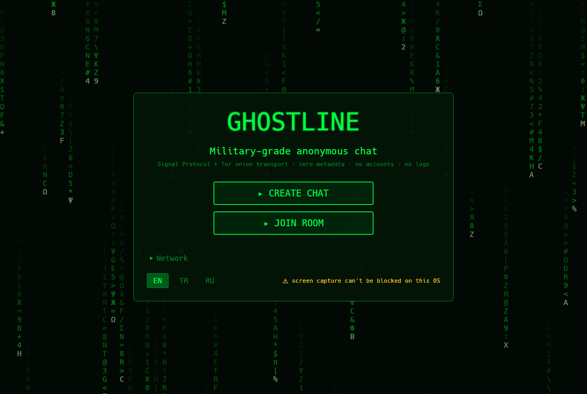
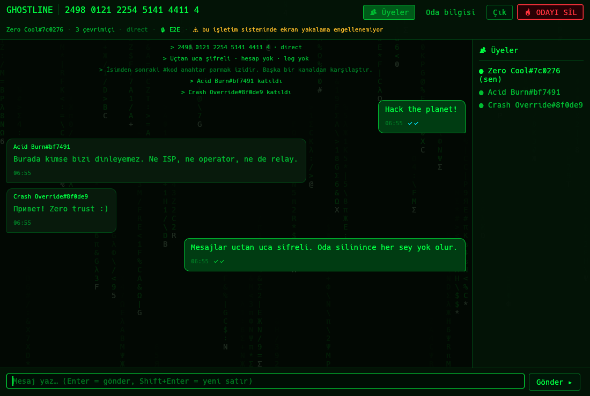
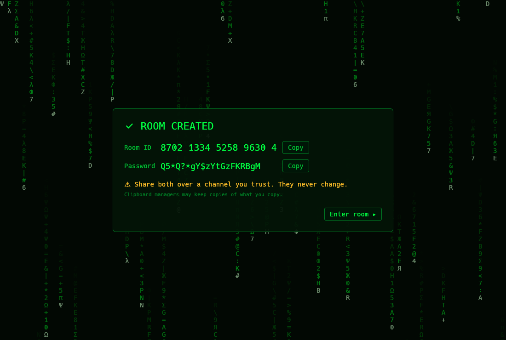

<p align="center"><a href="README.md">English</a> · <b>Türkçe</b> · <a href="README.ru.md">Русский</a> · <a href="README.de.md">Deutsch</a></p>

<p align="center"></p>

# GhostLine

**Askeri seviye anonim sohbet: Signal Protocol + Tor onion taşıma, sıfır metadata.**

<p align="center"><b><a href="https://github.com/canyorg/ghostline/releases/tag/latest">⬇ İndir (Windows / Linux)</a></b> · <b><a href="#kullanım-kılavuzu-adım-adım">📖 Kullanım kılavuzu</a></b></p>

Hesap yok. Telefon numarası yok. E-posta yok. IP adresi yok. User agent yok. Log yok.
Bir oda numarası ve parola alırsın, takma adını seçersin, konuşursun, işin bitince odayı yakarsın.

> ⚠️ **Durum: pre-alpha, henüz denetlenmedi.** Kullanılan yapı taşları köklü ve güvenilir
> (Tor, Argon2id, X25519, Ed25519, XChaCha20-Poly1305), ancak bu uygulama henüz bağımsız
> olarak incelenmedi. Bir denetim yapılana kadar can güvenliğinin bağlı olduğu durumlarda
> tek başına güvenme. [Bilinen sınırlamalar](#bilinen-sınırlamalar) bölümüne bak.

<p align="center"></p>

---

## Neden GhostLine? Zero trust (sıfır güven)

GhostLine, **hiç kimseye güvenmek zorunda kalmaman** için tasarlandı: hiçbir şirkete,
hiçbir uygulamaya, hiçbir sunucuya ve hiçbir GSM operatörüne.

- **Operatörler:** SMS ve operatör servisleri doğrudan dinlenebilir. Bunu operatörün kendisi,
  SS7 açıkları üzerinden başkaları ya da ağa erişimi olan herkes yapabilir. Üstelik telefon
  numarası doğrudan kimliğindir. GhostLine ikisini de kullanmaz.
- **WhatsApp kapalı kutu.** Signal Protocol kullandığını söylüyor, ancak uygulaması kapalı
  kaynak olduğu için bunu şirket dışından kimse kesin olarak doğrulayamaz. Ayrıca operatör
  metadata'yı (kim kiminle, ne zaman, ne sıklıkla konuşuyor) yine görür. Meta şirketine
  güvenmeyen çok sayıda insan var.
- **Zero trust** ilkesi "asla güvenme, her zaman doğrula" der. Özel iletişim için bunun
  anlamı açık kod, hesapsız ve numarasız kullanım, uçtan uca şifreleme ve kim olduğunu
  gizleyen bir ağ yoludur. Bu ilke gereği böyle bir uygulamanın kullanılması kaçınılmazdır.
- **Bize de güvenme.** Kod açık (AGPL-3.0). Oku, kendin derle, kendi relay'ini kur. Relay
  sadece şifreli veri tuttuğu için kötü niyetli bir relay bile işe yarar bir şey öğrenemez.

**Proje geliştirilebilir, fikirlerinizi bekliyoruz.** Bir [issue](../../issues) açabilir,
tartışma başlatabilir ya da pull request gönderebilirsiniz.

## Önerilen kurulum: GhostLine + Mullvad VPN

GhostLine, Tor sayesinde IP adresini relay'den zaten gizler. Gerçek gizlilik için Tor ve
GhostLine kullandığını **internet servis sağlayıcından (ISP)** da gizlemen gerekir. Bunun
için [Mullvad VPN](https://mullvad.net) öneriyoruz. E-posta veya kişisel bilgi istemez (sadece
hesap numarası), uygulamaları da açık kaynaklıdır. GhostLine'ı açmadan önce Mullvad'da
şunları aç:

| Ayar | Neden |
|---|---|
| **Kill switch** (her zaman açık) + **Lockdown mode** | VPN yeniden bağlanırken veya kapalıyken bile hiçbir trafik VPN dışına çıkmaz |
| **DAITA** | Dolgu ve sahte trafik ekler; yapay zeka tabanlı trafik analizi ne yaptığını tespit edemez |
| **Multihop (çoklu giriş) → Always** | Trafik bir Mullvad sunucusundan girer, başka birinden çıkar; hiçbir sunucu iki ucu birden görmez |

```
sen ──► Mullvad (2 atlama, DAITA) ──► Tor (3 atlama) ──► relay.onion (3 atlama)
        ISP sadece Mullvad'ı görür          relay IP görmez, sadece şifreli veri görür
```

Bu kombinasyon ideal sistemdir. VPN zorunlu değil, çünkü Tor tek başına IP adresini relay'den
gizliyor. Mullvad, ISP'ye ve yerel ağa karşı ek bir katman sağlar.

## Kullanım kılavuzu (adım adım)

> **Kısaca:** uygulamayı indir → relay'in `.onion` adresini yapıştır → "Tor hazır" yazısını
> bekle → **CHAT OLUŞTUR** ya da **ODAYA KATIL**. Ayrıntılar aşağıda.

### 1. İndirme ve kurulum

Rust, Git, Tor Browser ya da başka bir şey kurman **gerekmez**: uygulama tek bir dosyadır ve
Tor içindedir. En güncel sürüm her zaman burada (GitHub hesabı gerekmez):
**[Releases → latest](https://github.com/canyorg/ghostline/releases/tag/latest)**

#### Windows 10 / 11

1. **[ghostline-gui-x86_64-pc-windows-msvc.exe](https://github.com/canyorg/ghostline/releases/download/latest/ghostline-gui-x86_64-pc-windows-msvc.exe)** dosyasını indir.
2. Tarayıcı dosyayı tutmak isteyip istemediğini sorarsa **Koru / Keep** de.
3. *(İsteğe bağlı, önerilir)* Dosyanın değiştirilmediğini kontrol et. İndirilenler klasöründe
   PowerShell aç ve `Get-FileHash .\ghostline-gui-x86_64-pc-windows-msvc.exe -Algorithm SHA256`
   komutunu çalıştır. Çıkan değeri sürüm sayfasındaki `SHA256SUMS-x86_64-pc-windows-msvc.txt`
   ile karşılaştır.
4. `.exe` dosyasına çift tıkla. Dosya imzalı olmadığı için Windows *"Windows bilgisayarınızı
   korudu"* diyebilir: **Ek bilgi → Yine de çalıştır** de.
5. Kurulum yok. `.exe` dosyasını istediğin yerde tutabilirsin, örneğin masaüstünde.

#### Linux (Fedora, Ubuntu, Debian, Kali, Arch…)

```bash
cd ~/İndirilenler        # İngilizce sistemde: cd ~/Downloads
wget https://github.com/canyorg/ghostline/releases/download/latest/ghostline-gui-x86_64-unknown-linux-gnu
sha256sum ghostline-gui-x86_64-unknown-linux-gnu   # SHA256SUMS-x86_64-unknown-linux-gnu.txt ile karşılaştır
chmod +x ghostline-gui-x86_64-unknown-linux-gnu
./ghostline-gui-x86_64-unknown-linux-gnu
```

Terminal istemcisi (`ghostline-x86_64-…`) ve relay (`ghostline-relay-x86_64-…`) aynı
sayfada. Kaynak koddan derlemek için [Kaynak koddan derleme](#kaynak-koddan-derleme-geliştiriciler)
bölümüne bak.

### 2. Relay nedir, adres alanına ne yazmalıyım?

**Relay**, odadaki üyeler arasında **şifreli** mesajları taşıyan küçük bir posta kutusu
sunucusudur. Hiçbir şeyi okuyamaz ([Gizlilik nasıl sağlanıyor](#gizlilik-nasıl-sağlanıyor)).
Bir odadaki herkes **aynı relay'i** kullanmalıdır. Relay'i bir kişi ya da bir sunucu çalıştırır.

Relay'e `abcd…xyz.onion` gibi bir Tor **onion adresi** üzerinden ulaşılır. **Relay** alanına ne
yazacağın hangi bilgisayarda olduğuna bağlıdır:

| Şu an hangi bilgisayardasın? | **Relay** alanına yaz | Neden |
|---|---|---|
| **diğer tüm bilgisayarlar** (arkadaşın, laptopun, başka bir ağ) | `http://abcd…xyz.onion` | Tor seni relay'e taşır, hiçbir IP görünmez. **Port yazılmaz.** |
| **relay'in çalıştığı bilgisayarın kendisi** | `http://127.0.0.1:7878` (varsayılan, dokunma) | Relay sadece o bilgisayarın içinden dinler. Tor, `.onion` adresine gelenleri tam olarak bu porta yönlendirir. |

Vakit kazandıran kurallar:

- **`http://` ile başla**, `https://` değil. Tor, `.onion` bağlantılarını zaten şifreler ve
  doğrular. `http://` yazmayı unutursan uygulama kendisi ekler.
- **`.onion`'dan sonra port yazma.** `:7878` sadece relay bilgisayarının kendisinde kullanılır.
- **Adresi kopyala-yapıştır yap.** Tek harf hatası, başka (var olmayan) bir adres demektir.
- **Relay'in dinlediği adresi değiştirme.** `127.0.0.1:7878`'de kalmalı, böylece relay'e
  **sadece Tor üzerinden** ulaşılabilir. Ağa açarsan (`0.0.0.0`) insanlar Tor'suz bağlanabilir
  ve relay onların IP'sini görür.

### 3. Kendi relay'ini kur (bir kerelik kurulum, Linux)

Bunu sohbet ederken **açık ve internete bağlı** kalacak bir bilgisayarda ya da sunucuda yap;
ucuz bir VPS gayet iyi olur. Relay odaları **sadece RAM'de** tutar: relay durursa tüm odalar silinir.

```bash
# 1) relay'i indir
wget https://github.com/canyorg/ghostline/releases/download/latest/ghostline-relay-x86_64-unknown-linux-gnu
chmod +x ghostline-relay-x86_64-unknown-linux-gnu

# 2) Tor'u kur ve relay'i onion servisi olarak yayınla — SADECE BİR KERE
sudo dnf install -y tor                 # Debian/Ubuntu/Kali: sudo apt install -y tor
echo -e "HiddenServiceDir /var/lib/tor/ghostline/\nHiddenServicePort 80 127.0.0.1:7878" | sudo tee -a /etc/tor/torrc
sudo systemctl enable --now tor
sudo systemctl restart tor

# 3) relay adresin (bunu kişilerinle paylaş)
sleep 15; sudo cat /var/lib/tor/ghostline/hostname

# 4) relay'i başlat — bu terminali açık bırak
./ghostline-relay-x86_64-unknown-linux-gnu
```

- 2. adımı **sadece bir kere** çalıştır. Aynı satırları `torrc`'ye iki kez eklemek Tor'un başlamasını engelleyebilir.
- `.onion` adresi yeniden başlatmalarda değişmez. Adres `/var/lib/tor/ghostline/` klasöründe
  saklanır; adresi korumak istiyorsan bu klasörü silme.
- Modemde port açmana ya da sabit IP'ye gerek yok. Onion servisleri her ev modeminin arkasında çalışır.
- Tor'un çalıştığını kontrol et: `systemctl is-active tor` komutu `active` yazmalı.

### 4. Oda oluştur

1. Uygulamayı aç. **Ağ → Relay** alanına relay adresini yapıştır (yukarıdaki tabloya bak).
2. **Yerleşik Tor (önerilen)** seçili kalsın. İlerleme çubuğu dolup **"Tor hazır"** yazana kadar
   bekle. İlk açılış 10–60 saniye sürer.
3. **CHAT OLUŞTUR**'a tıkla.
4. Bir **takma ad** gir.
5. **Parola:** **Otomatik oluştur** seçili kalsın (en güçlüsü; **Şifre öner** yenisini verir) ya da
   **Kendim belirleyeceğim** seç (en az 12 karakter, iki kez).
6. **Odayı oluştur**'a tıkla. **Oda ID** ve **parola**, **Kopyala** butonlarıyla birlikte gösterilir.
7. İkisini de karşı tarafa güvendiğin bir kanaldan gönder (en iyisi yüz yüze). Hiç değişmezler.
8. **Odaya gir**'e tıkla.

### 5. Odaya katıl

1. Uygulamayı aç ve aynı **Relay** adresini gir.
2. **ODAYA KATIL**'a tıkla.
3. **Oda ID:** yaz ya da yapıştır. Boşluklar önemli değil. Yazım hatası anında yakalanır
   (*"kontrol hanesi yanlış"*).
4. **Parola:** yapıştır. Karakter karakter karşılaştırmak için **göster** kutusunu işaretle.
5. **Takma ad** gir ve **Katıl**'a tıkla. Tor üzerinden ilk bağlantı 10–30 saniye sürebilir.

### 6. Oda içinde

- **Gönder:** yaz ve **Enter**'a bas (**Shift+Enter** yeni satır).
- **İşaretler:** ⏳ gönderiliyor · ✔ relay'de · ✔✔ herkese ulaştı · **cyan ✔✔** herkes okudu.
- **Parmak izi:** `Acid Burn#afdb04`. `#kod` o kişinin anahtarına aittir. Birden değişirse
  karşındaki başka bir cihaz ya da başka bir kişidir.
- **Üyeler** odada kimlerin olduğunu, **Oda bilgisi** ID'yi ve parolayı tekrar gösterir.
- **Çık:** odadan çıkarsın; diğerleri yeni anahtar alır, sonrasını okuyamazsın.
- **🔥 ODAYI SİL:** butonu **1,5 saniye** basılı tut. Oda relay'den anında silinir, herkesin
  anahtarları temizlenir ve oda bir daha asla açılamaz.
- Yeni katılanlar, katılmadan önce gönderilen mesajları okuyamaz. Bu bilerek böyle.

### 7. Sorun giderme

| Mesaj | Anlamı / ne yapmalı |
|---|---|
| *room not found — or wrong password* (oda bulunamadı ya da parola yanlış) | Relay cevap verdi, yani Tor çalışıyor. ID ya da **parola** yanlış (tek karakter yeter) veya relay yeniden başlatılmış (odalar RAM'de durur). Parolayı kopyala-yapıştır yap ya da yeni oda oluştur. |
| *no relay is running on this computer (127.0.0.1)* (bu bilgisayarda relay yok) | Varsayılan adres kalmış. Relay bilgisayarı dışındaki her bilgisayarda relay'in `http://….onion` adresini gir. |
| *invalid relay URL* (geçersiz relay adresi) | Adresi kontrol et, `http://abcd…xyz.onion` şeklinde olmalı. |
| Tor düşük bir yüzdede kalıyor | İnternet yok ya da bu ağda Tor engelli. Önce Mullvad'a bağlan ya da başka bir ağ dene. |
| *could not reach the relay through Tor* (relay'e Tor üzerinden ulaşılamadı) | Relay bilgisayarı kapalı, relay programı çalışmıyor ya da orada Tor çalışmıyor (`systemctl is-active tor`). |
| *this room has been burned* (oda silinmiş) | Biri odayı silmiş. Yeni oda oluştur. |
| "Windows bilgisayarınızı korudu" | `.exe` imzalı değil: **Ek bilgi → Yine de çalıştır**. Önce SHA-256'yı kontrol et. |

## Gizlilik nasıl sağlanıyor

### Relay neden mesajlarını okuyamaz

Uçtan uca şifreleme, anahtarların **sadece üyelerin cihazlarında** bulunması demektir:

1. Parola bilgisayarından hiç çıkmaz. Argon2id onu senin cihazında oda anahtarına çevirir.
2. Her üye kendi cihazında yeni gizli anahtarlar üretir. Her üyenin mesaj anahtarları diğer
   üyelere tek tek, X25519 ile şifrelenerek verilir; oda parolasını bilen biri bile bunları açamaz.
3. Her mesaj gönderenin cihazında şifrelenir ve sadece alıcıların cihazında çözülür. Arada, yani
   Tor'da ve relay'de, dolgulu ve rastgele görünen bir veri yığınından ibarettir.

Relay hiçbir zaman parola, anahtar, takma ad ya da oda ID'si görmez. Okunamayan baytları rastgele
bir posta kutusu adresinde saklar. Kötü niyetli bir relay işletmecisi, sunucuya sızan bir hacker
ya da sunucuya el koyan polis okunabilir hiçbir şey elde edemez. Kullanılan anahtarlar hemen
silindiği için, bir cihaz sonradan çalınsa bile eski mesajlar açığa çıkmaz (forward secrecy).

### Tor IP adresini nasıl gizler: birbirini göremeyen 3 relay

```
sen ──► [1] giriş (guard) ──► [2] orta ──► [3] buluşma ◄── 3 atlama daha ◄── GhostLine relay (.onion)
        IP'ni bilir,             iki ucu da     ne senin IP'ni
        hedefi bilmez            bilmez         ne relay'inkini bilir
```

Trafiğin 3 kat şifreyle sarılır ("soğan"). Her relay sadece bir katı açar ve yalnızca bir önceki ile
bir sonraki adımı öğrenir:

- **[1] Giriş (guard)** IP adresini görür ama trafiğin nereye gittiğini görmez.
- **[2] Orta** ne seni ne de hedefi görür.
- **[3] Son relay** bir sonraki adımı görür ama senin IP'ni görmez.

Hiçbir relay iki ucu birden göremez; IP adresinin sızmamasının sebebi budur. GhostLine relay'i
de kendi 3 atlamasının arkasında bir onion servisi olarak çalışır. Yani toplam yol 6 atlamadır,
çıkış (exit) düğümü yoktur ve relay hiçbir IP öğrenmez.

**Risk:** **1. ve 3. relay (ya da senin giriş relay'in ile relay tarafı) aynı kişiye aitse**, bu
kişi iki uçtaki trafiğin zamanlamasını ve boyutunu eşleştirerek seni odaya bağlayabilir (*trafik
korelasyonu* saldırısı). Tor bunu, giriş relay'lerini uzun süre sabit tutarak ve aynı aileden ya da
aynı /16 ağdan relay'leri tek devreye koymayarak azaltır. Ancak güçlü kaynaklara sahip bir saldırgana
karşı tamamen ortadan kaldıramaz. **Tor'un önüne Mullvad koymanın mantığı tam olarak budur:** giriş
relay'in senin IP'ni değil, sadece bir Mullvad sunucusunu görür. DAITA da korelasyonun dayandığı
zamanlama ve boyut desenlerini bozar.

## Maksimum OPSEC: sanal makinede çalıştır

Maksimum operasyonel güvenlik için GhostLine'ı doğrudan Windows üzerinde değil, **Linux sanal
makinede (Fedora veya Kali)** çalıştır. Daha da güçlü seçenekler: tüm sanal makineyi Tor'dan geçiren
Whonix ve Tails.

**Neden Windows değil?** Windows, kalıcı bir cihaz kimliğine bağlı telemetri gönderir. 2026'da FBI,
Scattered Spider üyesi olduğu iddia edilen bir hacker'ı kısmen Windows'un **Global Device Identifier
(GDID)** kimliği sayesinde buldu: Aynı Windows kurulumu, kullandığı tüm VPN'ler ve IP'ler üzerinden
izlendi ve sonunda ev adresine bağlandı ([The Register](https://www.theregister.com/a/5267953), [CyberInsider](https://cyberinsider.com/microsoft-windows-telemetry-identified-hacker-despite-vpn-use/)).
Microsoft ayrıca, Microsoft hesabında saklanan BitLocker kurtarma anahtarlarını yasal bir kararla
yetkililere verdiğini doğruladı ([Tom's Hardware](https://www.tomshardware.com/tech-industry/cyber-security/microsoft-gave-customers-bitlocker-encryption-keys-to-the-fbi-redmond-confirms-that-it-provides-recovery-keys-to-government-agencies-with-valid-legal-orders)). Uçtan uca şifreleme seni kendi işletim
sisteminden koruyamaz. **Windows'ta Microsoft'un telemetrisi başlı başına bir OPSEC riskidir.**

Sanal makine kontrol listesi: Linux misafir sistem, tam disk şifreleme, ana makineyle ortak pano
ya da klasör yok, ana makinede veya sanal makinede Mullvad (lockdown mode + DAITA + multihop),
sanal makinede Tor ve kullanımdan sonra geri dönebileceğin bir snapshot.

## Özellikler

| | |
|---|---|
| 🔐 **Uçtan uca şifreleme** | **Şu an:** Signal'in grup yöntemi *Sender Keys*. Her üyenin ileri yönde değişen bir anahtar zinciri var (forward secrecy), anahtarlar X25519 ile kişiye özel dağıtılıyor, her mesaj Ed25519 ile imzalanıyor ve biri ayrılınca herkes anahtar yeniliyor. XChaCha20-Poly1305 ve HKDF-SHA256 kullanılıyor. **Sırada:** tam `libsignal` (PQXDH + Double Ratchet). |
| 🧅 **Yerleşik Tor** | Tor **uygulamanın içinde** (Arti, Tor Project'in Rust ile yazdığı Tor). Tor Browser'a ya da tor servisine gerek yok: uygulamayı açtığında Tor'a kendisi bağlanır. Her odanın devreleri ayrıdır ve devreler 10 dakikada bir yenilenir. Relay bir `.onion` servisi, yani yol 6 atlamalı, çıkış düğümü yok ve sunucu hiçbir IP görmez. Uzaktaki bir relay'e Tor'suz asla bağlanılmaz. İstersen harici Tor da (Tor Browser / tor servisi) kullanabilirsin. |
| 👻 **Sıfır metadata** | Hesap, IP, user agent ve kişi listesi yok. Relay, rastgele bir posta kutusu adresinde yalnızca dolgulu şifreli veriyi RAM'de tutar. Takma adlar sadece şifreli içeriğin içinde bulunur. |
| 🔢 **Sayısal oda ID'si** | Kripto cüzdanı veya Mullvad hesap numarası gibi: 16–23 hane, **uzunluğu her seferinde rastgele**. Damm kontrol hanesi, tek hanelik her yazım hatasını ve yan yana iki hanenin her yer değiştirmesini yakalar. |
| 🔑 **Oda parolası** | Kendi parolanı belirleyebilir ya da otomatik ürettirebilirsin. **"Şifre öner"** 16 karakterden uzun rastgele bir parola üretir (varsayılan ~123 bit). ID ve parola hiç değişmez. |
| 🏷️ **Odaya özel takma ad** | Odaya girerken seçilir, `takma_ad#parmakizi` olarak görünür. Unicode serbest; görünmez karakterler ve yazı yönünü değiştiren taklit karakterleri engellenir. |
| ✓✓ **İletim durumu** | ⏳ gönderiliyor · ✓ relay'de · ✓✓ herkese ulaştı · **cyan ✓✓** herkes okudu. Bilgilendirmeler şifreli gider, okundu bilgisi kapatılabilir. |
| 🚫 **Ekran görüntüsü koruması** | Windows'ta masaüstü uygulaması ekran görüntüsünde, ekran kaydında ve ekran paylaşımında görünmez. Linux'ta ve terminal istemcisinde bu mümkün değil, sınırlamalara bak. |
| 💥 **Odayı yak** | `/burn`: relay posta kutusunu anında siler (bir daha oluşturulamaz) ve tüm üyelerin istemcileri anahtarları siler. |
| 🟩 **Hacker arayüzü** | Matrix yağmurlu, mesaj balonlu, basılı tutunca silen **masaüstü uygulaması** (Linux + Windows). Türkçe, İngilizce, Rusça ve Almanca. Yanında siyah üzerine yeşil **terminal istemcisi** de var ve ikisi birbiriyle konuşabiliyor. |
| 🧱 **Web motoru yok** | Masaüstü uygulaması saf Rust (egui): WebView, JavaScript ve HTML yok. Mesajlar her zaman düz metin olarak çizilir. Diske mesaj, ayar veya geçmiş yazılmaz; Tor Browser'daki gibi sadece Tor'un guard/dizin bilgisi tutulur (`GHOSTLINE_AMNESIC=1` ile hiçbir şey). |

## Kaynak koddan derleme (geliştiriciler)

[Rust](https://rustup.rs) gerekir. Linux'ta (Fedora, Debian, Arch…), Windows 10/11'de
(PowerShell, Windows Terminal) ve macOS'te çalışır.

```bash
git clone https://github.com/canyorg/ghostline && cd ghostline
cargo build --release
```

Çalıştırılabilir dosyalar `target/release/` klasörüne çıkar (Windows'ta sonlarında `.exe` olur):

| Dosya | Ne işe yarar |
|---|---|
| `ghostline-gui` | masaüstü uygulaması |
| `ghostline` | terminal istemcisi |
| `ghostline-relay` | relay sunucusu |

### Masaüstü uygulaması

```bash
./target/release/ghostline-relay &        # yerel test için; gerçek kullanımda .onion relay
./target/release/ghostline-gui
```

**CHAT OLUŞTUR** → takma ad → parola (otomatik üretilir ya da kendin belirlersin; **Şifre öner**
yenisini verir) → oda ID'si ve parola kopyalama butonlarıyla gösterilir → **Odaya gir**.
**ODAYA KATIL** → oda ID'si (yazım hataları yazarken yakalanır) → parola → takma ad.

Oda içinde: 👥 üyeler, oda bilgisi (ID ve parolayı tekrar paylaşmak için), **Çık** ve
**🔥 ODAYI SİL**: 1,5 saniye basılı tutunca oda herkes için anında yok olur. Relay ve Tor ayarları
başlangıç ekranındaki **Ağ** bölümünde. Dil sistem dilini takip eder (TR/EN/RU/DE), aynı ekrandan
değiştirilebilir.

<p align="center"> </p>

### Terminal istemcisi

3 terminalde yerel deneme:

```bash
# terminal 1 — relay (sadece RAM'de çalışır, hiçbir şey loglamaz)
./target/release/ghostline-relay

# terminal 2 — oda oluştur (parola sorulunca Enter'a basarsan otomatik üretilir)
./target/release/ghostline create --nick "Zero Cool"

# terminal 3 — terminal 2'de görünen ID ve parola ile katıl
./target/release/ghostline join 1076 7380 0491 6080 894 --nick "Acid Burn"
```

Windows'ta aynı argümanlarla `.\target\release\ghostline.exe` kullan.

Oda içindeki komutlar: `/help` · `/who` · `/info` · `/quit` (Ctrl+C) · `/burn`

### Tor üzerinden (gerçek kullanım)

1. **Relay'i onion servisi olarak çalıştır** (herhangi bir Linux makinede):

   ```bash
   sudo dnf install tor          # Debian/Ubuntu: sudo apt install tor
   sudo tee -a /etc/tor/torrc <<'TORRC'
   HiddenServiceDir /var/lib/tor/ghostline/
   HiddenServicePort 80 127.0.0.1:7878
   TORRC
   sudo systemctl restart tor
   sudo cat /var/lib/tor/ghostline/hostname     # → abcd…xyz.onion
   ./target/release/ghostline-relay              # 127.0.0.1'de kalır
   ```

2. **İstemcilerde ek bir şey gerekmez.** Tor uygulamanın içinde. `.onion` adresini masaüstü
   uygulamasında **Relay** alanına yapıştır, terminalde `--relay` ile ver. İlk açılışta Tor'un
   bağlanması 10–60 saniye sürer (ilerleme çubuğu görünür), sonraki açılışlar daha hızlıdır.

   ```bash
   ghostline create --relay http://abcd…xyz.onion
   ghostline join <ID> --relay http://abcd…xyz.onion
   ghostline join <ID> --relay http://abcd…xyz.onion --external-tor --tor-port 9150   # Tor Browser kullanmak istersen
   ```

   Yerleşik Tor, Tor Browser gibi giriş (guard) relay'lerini ve bir dizin önbelleğini hatırlar
   (`~/.local/share/ghostline/arti`, Windows'ta `%LOCALAPPDATA%\ghostline\arti`). Sabit giriş
   relay'leri seni korelasyona karşı **korur**. Hiç iz bırakmamak istersen `GHOSTLINE_AMNESIC=1`
   ayarla: Tor geçici bir klasör kullanır ve çıkışta siler.

   İpucu: `export GHOSTLINE_RELAY=http://abcd…xyz.onion` (PowerShell: `$env:GHOSTLINE_RELAY="…"`).

## Oda nasıl çalışır

```
OLUŞTUR                                  KATIL
takma ad: Zero Cool                      oda id  : 3414 7650 6754 3639 1733 042
oda id  : 3414 7650 6754 3639 1733 042   parola  : ********************
parola  : [otomatik]  [şifre öner]       takma ad: Acid Burn
        └──► Argon2id(parola, id) ──► oda anahtarı · posta kutusu id · silme anahtarı
```

ID tek başına işe yaramaz: posta kutusu adresi **paroladan** türetildiği için parola olmadan
oda bulunamaz bile. Yanlış parola ile var olmayan oda birbirinden ayırt edilemez.

Ayrıntılar: [`docs/ARCHITECTURE.md`](docs/ARCHITECTURE.md) · [`docs/THREAT_MODEL.md`](docs/THREAT_MODEL.md)

## Bilinen sınırlamalar

Bir güvenlik aracı neyi **yapamadığını** açıkça söylemeli:

1. **Silme sadece değiştirilmemiş istemcilerde garanti.** "Odayı yak" relay'deki veriyi ve
   dürüst istemcilerdeki her şeyi siler. Değiştirilmiş bir istemci veya mesajları önceden
   kopyalamış biri bunları saklayabilir. Hiçbir mesajlaşma uygulaması bunu engelleyemez.
2. **Ekran görüntüsü koruması sınırlı.** Terminal istemcisinde koruma yok. Windows masaüstü
   uygulaması pencereyi ekran yakalamadan gizler, ancak sanal makine veya capture kartı ile
   aşılabilir. Linux'ta bu mümkün değil (X11'de engellenemez, Wayland'de compositor'a bağlı).
   Ekranın telefonla fotoğrafının çekilmesini hiçbir yazılım engelleyemez.
3. **Ele geçirilmiş bir cihaz her şeyi boşa çıkarır.** Zararlı yazılım veya kilidi açık
   bilgisayarının başındaki biri, senin gördüğün her şeyi görür.
4. **Oda parolası ortak bir sırdır.** ID'yi ve parolayı bilen herkes odaya girebilir ve odayı
   yakabilir. Forward secrecy sayesinde geçmiş mesajları okuyamaz.
5. **Zayıf parolalar çevrimdışı kırılabilir.** Bunun için relay verisine erişim gerekir.
   Argon2id (128 MiB) bunu ciddi şekilde yavaşlatır, yine de üretilen parolaları kullan.
6. **Trafik korelasyonu.** Senin 1. Tor relay'in ile 3. relay (ya da relay tarafı) aynı kişinin
   elindeyse, ya da biri ağın iki ucunu birden izliyorsa, zamanlamayı ve boyutları eşleştirerek seni
   odaya bağlayabilir. Tor bunu zorlaştırır ama imkansız kılmaz. Tor'un önüne Mullvad koy (multihop +
   DAITA) ve gerekirse okundu bilgisini kapat. [Gizlilik nasıl sağlanıyor](#gizlilik-nasıl-sağlanıyor) bölümüne bak.
7. **Relay işletmecisi şunları görür:** posta kutusu ID'leri, dolgulu boyutlar ve verinin geliş
   zamanları. IP, takma ad, oda ID'si, parola ve içerik **görmez**.
8. **Tor'un engellendiği ülkelerde** köprü (bridge) kullanman ya da Tor'un önüne Mullvad koyman gerekir.
9. **Bellek temizliği en iyi çaba esaslıdır.** Anahtarlar kullanıldıktan sonra silinir, ancak
   swap, hazırda bekletme dosyası ve çökme dökümlerinde kalıntı olabilir. Tam disk şifreleme kullan.
10. **Grup şifrelemesi ara çözüm.** v0'daki Sender Keys forward secrecy sağlar ama
    post-compromise security sağlamaz. libsignal yol haritasında.
11. **Parmak izleri kısa.** `#1a2b3c` 24 bit: birinin yerine başkasının geçtiğini fark etmeye
    yeter, kimliği kanıtlamaya yetmez.
12. **Henüz denetlenmedi.**
13. **İşletim sistemin seni ele verebilir.** Windows telemetrisi yaptıklarını kalıcı bir cihaz
    kimliğine bağlar. GhostLine'ı Linux sanal makinede çalıştır, [Maksimum OPSEC](#maksimum-opsec-sanal-makinede-çalıştır) bölümüne bak.

## Yol haritası

- [x] **M1** Oda ID'leri (Damm), parola üretici, takma ad doğrulama, Argon2id/HKDF
- [x] **M2a** Uçtan uca grup mesajlaşması (Sender Keys), imzalar, dolgu, ✓/✓✓, ayrılışta anahtar yenileme
- [x] **M3** Relay: sadece RAM, log yok, TTL, anında silme ve kalıcı silinme kaydı (tombstone)
- [x] **CLI** Linux ve Windows terminal istemcisi, SOCKS ile Tor
- [x] **M6a** Odayı yakma
- [x] **M5** Masaüstü uygulaması (Linux + Windows): matrix arayüzü, balonlar, ✔/✔✔, basılı tutarak silme, Windows'ta ekran yakalama engeli, TR/EN/RU/DE
- [ ] **M2b** `libsignal` (PQXDH + Double Ratchet)
- [x] **M4a** Yerleşik Tor (Arti): oda başına ayrı devre, 10 dakikada bir devre yenileme, iz bırakmayan mod
- [ ] **M4b** Tor'un engellendiği ülkeler için köprüler (bridges)
- [ ] **M6b** Panik silme, isteğe bağlı şifreli yerel geçmiş
- [ ] **M7** Android
- [ ] **M8** Bağımsız güvenlik denetimi

## Katkı

Fikirler, hata bildirimleri, çeviriler, kod incelemeleri ve pull request'ler memnuniyetle
karşılanır. Güvenlik açıklarını lütfen [SECURITY.md](SECURITY.md)'de anlatıldığı gibi gizli bildir.

```bash
cargo test                                   # birim testleri + protokol simülasyonu
cargo clippy --all-targets -- -D warnings
```

```
crates/core    protokol çekirdeği: ID, KDF, kripto, mesaj formatı, oturum
crates/relay   relay sunucusu (sadece RAM, log yok)
crates/client  ortak katman: relay bağlantısı (Tor/SOCKS), oluştur/katıl, oda sürücüsü
crates/cli     terminal istemcisi `ghostline`
crates/gui     masaüstü uygulaması `ghostline-gui` (egui)
docs/          mimari ve tehdit modeli
```

## Lisans

AGPL-3.0-or-later.
